# Define Language Proposal 56: Logical Operations for Boolean Values

- **Author:** Max Kanat-Alexander
- **Status:** Draft
- **Date Proposed:** October 29, 2026
- **Date Finalized:**

## Problems

Now that we have [DLP 55 (Logical Operations)](00055-logical-operations.md), we
need to say what logical operations the compiler fundamentally knows about.

The most fundamental operations the compiler can know about are operations on
boolean values (true and false). Other logical operations often depend on
boolean values, but the fundamental boolean operations don't depend on other
types of values.

This is also the first proposal discussing the specifics of any logical
operations, so we have to discuss a few of the general problems of categorizing
logical operations.

Note: For some of the background research behind this proposal, see
[Numeric Operation Requirements](background/numeric-operation-requirements.md).
It's mostly about numbers, but it also discusses a bit about which logical
operations boolean values need. For research on representing boolean logic in a
compiler, see
[Representations of Boolean Logic](background/boolean-logic-representations.md).

### 1: How Many Logical Operations Are There?

The core question we have to answer is: what logical operations should the
compiler implement, and which should be composed into value operations?

### 2: Equality

How do we check that two boolean values are equal? Can a boolean value ever be
equal to some other type, like a number?

### 3: Combining Conditions

At some point we will have the ability to compare things: ("less than," "greater
than", "equal to") or make other assertions that result in a boolean value. We
have to be able to combine or negate those conditions. "Is x between a and b?"
is two comparisons that both have to be true. "a is at most b" is the opposite
of "b is less than a." Is it special syntax in Define, as it is in other
languages, or is it just its own set of logical operations?

### 4: Circuits vs Compilers

In theoretical abstract circuits, the only two that implement all possible
boolean logic by themselves are NAND and NOR (the relevant theorem is Post's
functional completeness theorem, though you don't have to understand that at all
to reason through this proposal).

When you're reasoning with a compiler through logic and want to do
optimizations, though, one of the problems with NAND by itself is that it's not
associative. If all you have is NAND, it can be challenging to reorder equations
for optimization or to prove two equations are equivalent. (At the very least,
you have to first decompose it to `not` and `and` and then determine if there is
some way to safely reassociate.)

In real hardware, there are specialized gates for specialized purposes. For
example, real chips usually use some combination of XOR and NOT (an XNOR
implementation) to implement equality. However, if we expose every possible
logic gate as a core primitive of Define, there become too many ways to write
the same core logic.

### 5: Representations of Boolean Expressions in Compilers

In compilers and formal verification systems, there have traditionally been a
few different options for how to represent boolean logic conceptually in the
compiler. This matters for us because ideally, we would _start_ with the most
efficient form written in the source so the compiler just does a linear pass and
converts that directly into its in-memory representation. It also matters
because we're writing a compiler and we will need to represent and calculate on
these things somehow, so it's worth making sure that our fundamental design
supports that in a sensible way.

Thus, here is an overview of various ways of representing boolean equations.

#### And-Inverter Graph (AIG)

This form is the most common for circuit verification, it has only two different
operators, `and` and `not`.

It is a DAG consisting of:

- Nodes: Two-input AND operations.
- Edges: Connections that can optionally invert their values.
- Leaves: Primary inputs or constants.

##### Examples

Following are some examples of what the DAG of an AIG looks like.

"And": a single node:

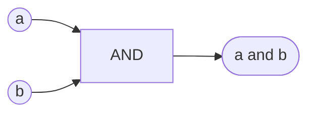

"Or" by De Morgan's Law: `not (not a and not b)`:

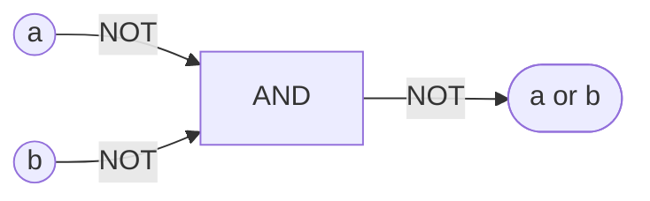

Equality (XNOR): three AND nodes:

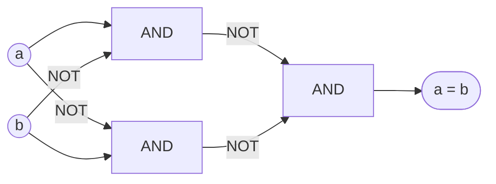

##### Structural Equivalence Issues with AIGs

AIGs have one unintuitive property: equivalent logic does not always produce
equivalent graphs.

`(a and b) and c`:

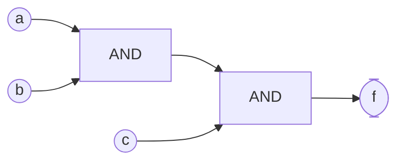

`a and (b and c)`:

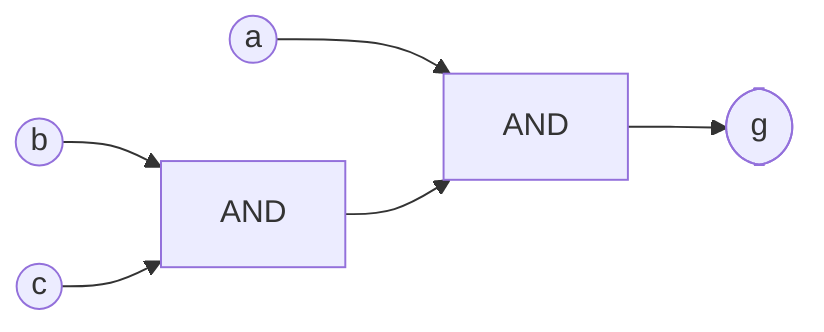

If you combine those graphs, you get two different values that are actually
identical, but the graph alone doesn't show it:

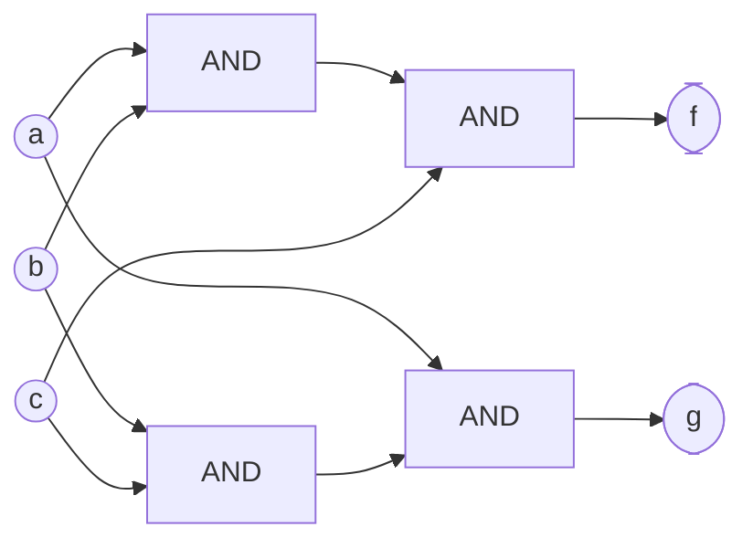

`f` and `g` there are actually equal.

There are a few potential solutions.

##### Balancing AIGs

The simplest solution to the specific problem above (associativity getting lost)
is **balancing**.

Imagine this four-input chain of ANDs: `f = ((a and b) and c) and d`.

In an AIG, each AND has to "wait" for the one before it, so the result goes
through three ANDs in a row:

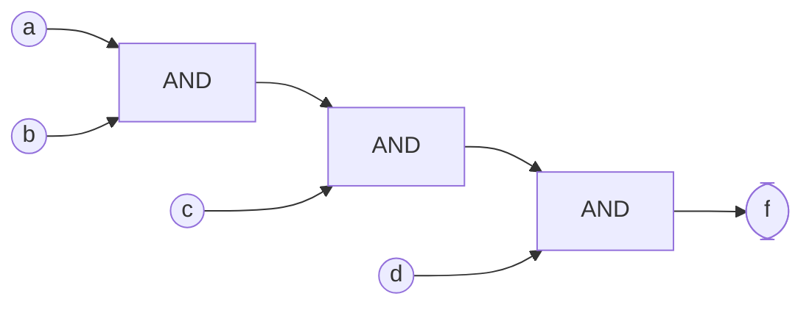

But `f` is really just "a, b, c and d are all true." Grouping doesn't change
that, so balancing regroups the inputs into pairs:
`f = (a and b) and (c and d)`.

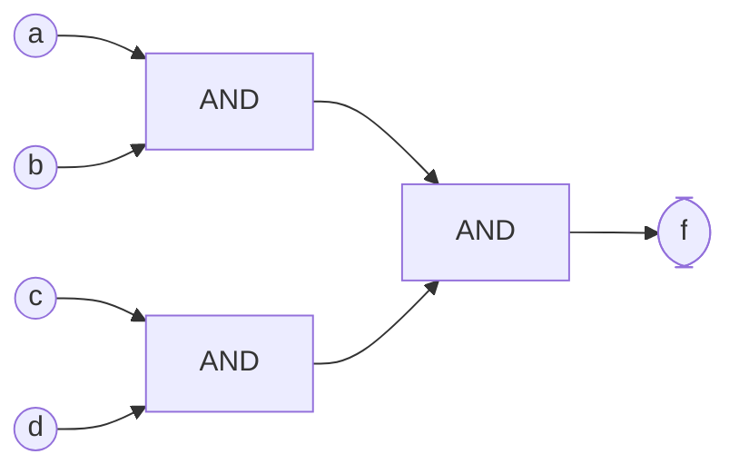

It's still three ANDs. But `a and b` and `c and d` can happen at the same time,
so the result only goes through two ANDs in a row instead of three.

##### How Balancing AIGs Works

The algorithm is written knowing that AND is associative (grouping doesn't
matter) and commutative (order doesn't matter). Together, those mean any AND of
a set of inputs equals any other way of combining that same set. Since every
node in an AIG is an AND, that one fact covers every node.

The primary thing the algorithm has to check is whether a group of nodes really
is one big AND, without a NOT intervening somewhere. `not (a and b) and c` is
not equivalent to `not a and (b and c)`.

Worst case, the algorithm to determine that form is quadratic, but usually the N
is small and so that doesn't matter. It also indicates that there are multiple
equivalent AIG DAGs, which is a bit more of a problem if we want to calculate
that two conditions are structurally equivalent.

##### Substitution in AIGs

There's also one other issue with the algorithm, which comes up mostly when you
care about circuit design. However, the problems of circuit design also become
problems of code generation, so it's worth considering it from that lens.

The problem is best explained through examples. Imagine that you have a set of
equations like this:

```python
x = a and b
f = (x and c) and d
g = x and e
```

If we substituted in `x`, we would see a pretty straightforward set of
conditions we could reduce:

```python
f = ((a and b) and c) and d
g = (a and b) and e
```

That's pretty easy. But what if there were hundreds of things to substitute in
like that?

```python
x  = a1 and a2 and ... and a100      (99 ANDs)
f1 = x and y1
f2 = x and y2
...
f100 = x and y100                    (100 more ANDs)
```

That's 199 ANDs. If we substitute the actual definition of `x` into each of
those computations, each one separately becomes its own tree of 100 ANDs. That's
10,000 ANDs fed into a quadratic algorithm that are recomputing a balancing we
could have computed just once for `x`. That gets you an algorithm with 1,000,000
operations that requires 10,000 gates in a circuit, if you're generating code
straight from the AIG.

Let's look at this for our simpler example again.

```python
x = a and b
f = (x and c) and d
g = x and e
```

**Before balancing:** `x` is shared by `f` and `g`.

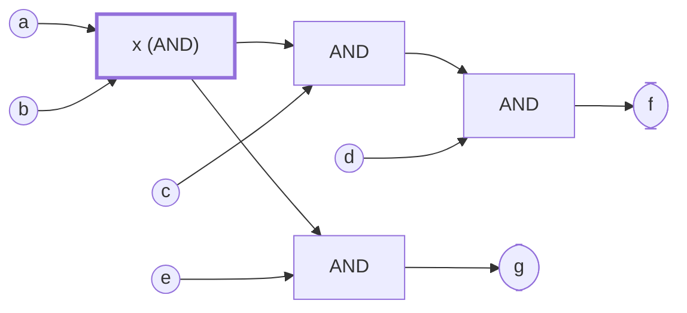

That's four ANDs. But you can see what happens if you _do_ substitute in `x`
(just count the number of ANDs):

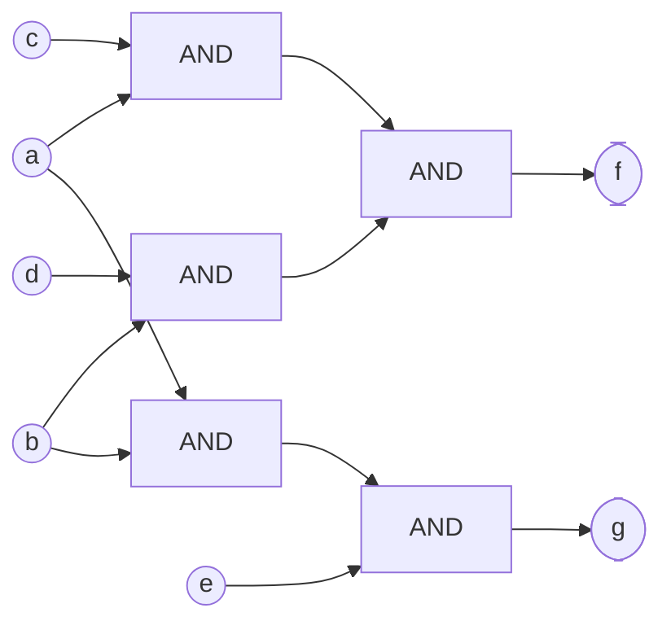

What if we treat `x` as just one input, but still balance the DAG?

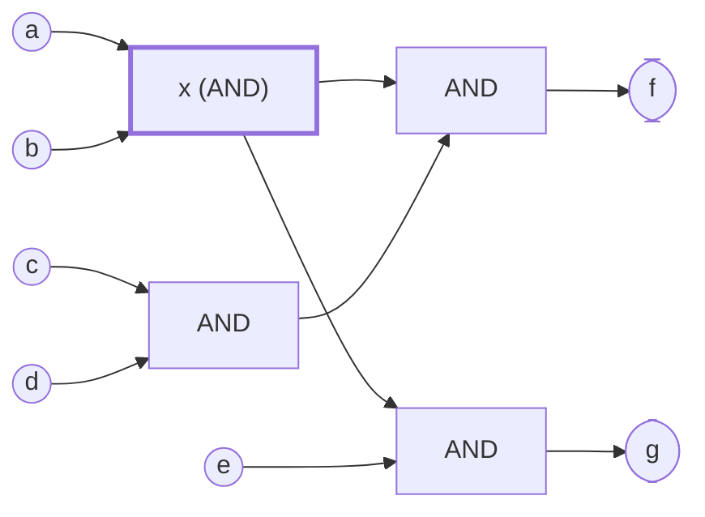

Ah ha, we're back to 4 ANDs. So you see that the circuit does not grow at all,
in this case. Growth wasn't a huge problem here (one extra gate) but it was a
very real problem in our "10,000 gate" situation up above.

Thus, the usual rule that AIGs follow is: when a node has more than one consumer
(like `f` and `g` in our above examples), treat it as a single input and don't
"look inside" it. The problem, for us, is that _anything_ could be inside of `x`
and it prevents us from knowing if somebody has written the same program in more
than one way.

##### SAT Sweeping

Balancing can't prove that all equivalent logic is equivalent. For example
`a and (a or b)` is actually just `a`. In AIG form, that's
`a and not (not a and not b)`. Balancing that does not reduce it to `a`.

Thus, most AIGs use something called "SAT sweeping" to solve this in the general
case, which uses random simulation to spot nodes that might be equal, then uses
a SAT solver to prove it and merges them. Of course, that's not guaranteed to
produce optimal or canonical constructions, and SAT is NP-complete (though
practical SAT solvers usually have totally reasonable performance). Also, as
noted in other docs, SAT solvers often produce difficult error messages when
they fail (they can tell you that the whole equation failed but it's harder to
get them to be clear about what part of the _code_ is at fault).

It's worth noting that when a full equation depends on six or fewer inputs, SAT
isn’t needed. Six inputs have 2^6 = 64 combinations, so the whole function fits
in one 64-bit word and you can do bit operations on it directly. With larger
registers you could do more, too, or even just use bitvectors to do a lot of
this more efficiently at larger sizes. In other words, most common problems
actually end up not needing SAT in real implementation.

#### XOR-AND Graph (XAG)

In circuit design, especially cryptographic circuit optimization, there is a
form roughly equivalent to an AIG called an XOR-AND Graph. It requires the
operations `xor`, `and`, and the literal value `true`.

```python
# Original
f = a or b

# Using XOR + AND
f = a ^ b ^ (a and b)
```

Inversions can be represented as an XOR with True, instead of having a not:

```python
not_a = a ^ True
```

It's worth noting that you can express the same concepts with `xor` and `or` and
`True`, instead, too.

Generally you would favor an XAG over an AIG when you expect to have a lot of
XOR logic. For example, consider this `xor` of four variables:

```python
f = a ^ b ^ c ^ d
```

An XAG represents that with three `xor` nodes:

```python
x = a ^ b
y = c ^ d
f = x ^ y
```

However, an AIG requires nine AND nodes:

```python
# XOR(a, b, c, d), expressed using AND and NOT
x = not (a & b) & not (not a & not b)
y = not (c & d) & not (not c & not d)
f = not (x & y) & not (not x & not y)
```

It's worth considering not just how often developers _write_ XORs when thinking
through the efficiency here, but how often your compiler _produces_ XORs
internally.

XAGs are a bit less commonly used than AIGs, so the software ecosystem around
them can also be less mature.

#### Majority Inverter Graphs (MIGs)

There has been an interesting alternative to AIGs and XAGs emerging in hardware
verification: Majority-Inverter Graphs. It uses a special gate called a
"majority" gate which returns true when at least two of its three inputs are
true. Roughly:

```python
majority(a, b, c) = (a and b) or (a and c) or (b and c)
```

MIGs can express ordinary AND and OR by simply using a literal in the third
term:

```python
a and b == majority(a, b, False)
a or b == majority(a, b, True)
```

These are used primarily because they can optimize arithmetic circuits more
efficiently than an AIG or XAG. In particular, carry-type operations are often
just `majority(a, b, c)` alone.

That's not extremely relevant for us, but the pattern was worth mentioning.

#### Conjunctive Normal Form (CNF)

Conjunctive Normal Form (CNF) is a way of representing Boolean logic as an AND
of ORs. It's the standard input representation for most modern SAT solvers.

A CNF formula looks like this:

`(a or b) and (not a or c) and (b or not c)`

Each parenthesized OR is called a clause. Each variable or negated variable is
called a literal.

The rules are simple:

- The outermost operation must be an AND.
- Each clause contains literals joined by OR.
- NOT can only apply directly to variables.

A formula is true only when every clause is true.

##### What can CNF express?

Every Boolean function can be expressed in CNF.

Some examples:

| Boolean expression | CNF                             |
| ------------------ | ------------------------------- |
| `a AND b`          | `a and b`                       |
| `a OR b`           | `(a or b)`                      |
| `a → b`            | `(not a or b)`                  |
| `a XOR b`          | `(a or b) and (not a or not b)` |

CNF doesn't restrict what Boolean functions can be represented.

##### Avoiding exponential growth

Some boolean functions require exponentially many clauses to be represented as
CNF.

Consider `(a and b) or (c and d)`. That's very simple to write. However,
converting that to CNF becomes
`(a or c) and (a or d) and (b or c) and (b or d)`. Two clauses became four, but
it's not just a constant doubling. With `n` AND pairs, an expansion of OR
clauses requires `2^n` AND clauses.

SAT solvers avoid this using the Tseitin transformation, which introduces
auxiliary variables for intermediate results. For example, imagine we have:

```python
x = a and b
y = c and d
z = x or y
```

First, let's convert _equality_ into CNF. For example, saying that `x` equals
`a and b` looks like this, in CNF:

```python
(not x or a) and
(not x or b) and
(x or not a or not b)
```

We do the same for `y`:

```python
(not y or c) and
(not y or d) and
(y or not c or not d)
```

And now for `z`:

```python
(not x or z) and
(not y or z) and
(x or y or not z)
```

Now we can simply combine all of those statements into a single CNF statement:

```python
cnf = (
    (not x or a)
    and (not x or b)
    and (x or not a or not b)
    and (not y or c)
    and (not y or d)
    and (y or not c or not d)
    and (not x or z)
    and (not y or z)
    and (x or y or not z)
    and z
)
```

That's way more terms than our original equation, but it only grew _linearly_
with the size of the number of clauses in our original equation, not at 2^n. So
direct expansion is more efficient at smaller n, but Tseitin transformation is
much better at larger n.

All that said, it's worth noting that a Tseitin transformation is not logically
equivalent to the original equation, it's only "equisatisfiable."

Two Boolean expressions are equisatisfiable if either both can be true for some
assignment of their variables, or neither can.

For example:

```python
f = a
g = not a
```

Both are satisfiable (`f` when `a = True`, `g` when `a = False`), so they are
equisatisfiable. However, they are obviously not logically equivalent.

However, Tseitin is actually still the most common way to do equivalence checks
in SAT solvers. All you have to do is check if `f xor g` is true. If that can't
be satisfied, `f` and `g` are equivalent. That's much more efficient to _encode_
than a lot of other representations, because the encoding is always linear in
size compared to its inputs. Solving it is coNP-hard in the worst case, but in
practice there are efficient algorithms that deal with almost all common
situations. ABC (a widely-used open-source circuit analysis tool) checks
equivalence with this method plus SAT sweeping, on circuits with millions of
gates.

##### Why SAT solvers use CNF

CNF makes it easy to propagate logical consequences. For example, consider
`(a or b) and (not b or c)`. If we assign `a = false`:

1. The first clause forces `b = true`.
2. The second clause then forces `c = true`.

This is called "unit propagation." Modern SAT solvers use unit propagation and
other techniques against CNF to search efficiently for satisfying assignments.

#### Binary Decision Diagrams (BDDs)

A directed acyclic graph of boolean decisions. Each node tests a variable and
selects one of two branches (true or false). Thus, every node in the graph has
exactly two outbound edges. For example:

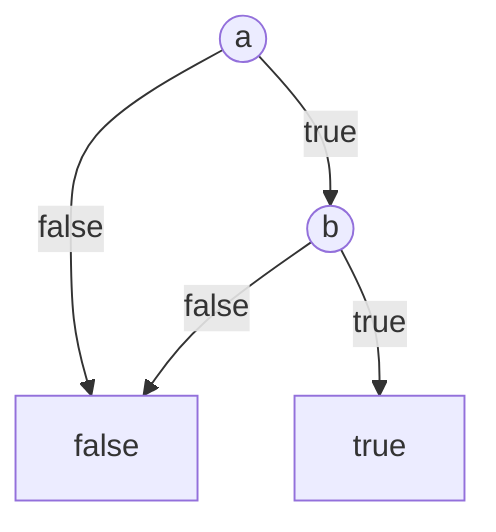

Any boolean expression can be converted into a BDD (though some conversions take
exponential time).

What makes BDDs interesting is that they can prove that any two finite boolean
equations are logically equivalent, no matter how those equations are written.
They do this via a form called a Reduced Ordered Binary Decision Diagram
(ROBDD), which is produced by a specialized algorithm.

In terms of the _theory_ of BDD, it doesn't matter how we choose to structure
Define's syntax, because it can handle any form of boolean equation, and that
equation can always be reduced down to a canonical form. However, using BDD to
prove that two arbitrary boolean expressions are equivalent is exponential (2^n)
in the worst case. For example, one of the classic cases is the "hidden weighted
bit" (HWB) function:

```python
def hidden_weighted_bit(a: bool, b: bool, c: bool, d: bool) -> bool:
    """Compute the Hidden Weighted Bit (HWB) function for four Boolean inputs.

    Count how many inputs are True, then return the input at that
    position (counting from 1). If all inputs are False, return False.

    For example:
        hwb(True, False, True, False) -> False
            Two inputs are True, so return the second input (b).

        hwb(True, True, False, False) -> True
            Two inputs are True, so return the second input (b).

        hwb(True, True, True, False) -> True
            Three inputs are True, so return the third input (c).

    HWB is notable because it can be computed with a polynomial-size
    Boolean circuit, but requires an exponentially large reduced
    ordered binary decision diagram (ROBDD).
    """
    # Exactly one input is true, and a is true.
    one = a and not b and not c and not d

    # Exactly two inputs are true, and b is true.
    two = (
        (a and b and not c and not d)
        or (not a and b and c and not d)
        or (not a and b and not c and d)
    )

    # Exactly three inputs are true, and c is true.
    three = (
        (a and b and c and not d)
        or (a and not b and c and d)
        or (not a and b and c and d)
    )

    # Exactly four inputs are true, and d is true.
    four = a and b and c and d

    return one or two or three or four
```

I would say that any programming language must be _able_ to express HWB, or it's
not a very useful programming language. HWB is not exactly a _common_ operation,
but doing large-scale static analysis could still get us into similar levels of
complexity in terms of condition analysis, especially if we try to prove that
two boolean equations are equivalent, in order to tell the programmer they can't
write two identical things in two different ways.

There are optimized implementations of BDD that work around some of these issues
through better graph algorithms and caching of already-seen expressions.

The interesting question for us is: are there restrictions we could or should
impose upon Define that would make BDD a tractable or good option for us? We
already have some properties that make calculation somewhat easier: every
compiled component of Define produces a static, finite DAG. That helps with
constructing the BDD, but it doesn't help with the ROBDD algorithms.

Let's go over some other potential restrictions.

##### Read-Once Formulas

If every variable appears only once in a formula, then the formula can be
normalized into an ROBDD and equivalence checked in polynomial time. So, for
example, imagine you have something like:

```python
x = a and b
y = x and c
```

The equation producing `y` can be checked for equivalence in polynomial time.

So you might think, "Okay, so we could just require all boolean conditions to be
written in a read-once form by expanding our aliasing rules so that a variable
never appears more than once inside a value operation." In other words, you
might think that we could transform:

```python
x = a and b
y = c and a
z = x and y
```

into:

```python
x = a and b
d = a  # Copy this so it looks "independent" to the BDD checker.
y = c and d
z = x and y
```

You'd have to copy `a` around, but the compiler could probably eliminate that
copy in the backend, so you'd probably be fine.

Unfortunately, this allows two actually-equivalent formulas to be "proven"
distinct. To understand this, consider these two equivalent programs:

Program 1

```python
x = a and b
y = x and a
```

Program 2

```python
y = a and b
```

Now introduce a copy in Program 1, treating `d` as an independent input:

```python
x = a and b
d = a  # Treated as an independent input for verification
y = x and d
```

The equivalence checker now compares: `f = a and b and d` (Program 1) with
`g = a and b` (Program 2) to see if they are equivalent.

It finds this counterexample:

| Variable | Value |
| -------- | ----- |
| a        | true  |
| b        | true  |
| d        | false |
| f        | false |
| g        | true  |

So it reports that they are not equivalent.

However, that counterexample is impossible in the original program, because
`d = a`. Thus, unfortunately, by treating copies as independent inputs, we would
introduce additional possible states into the BDD graph, which can produce false
equivalence failures.

Completely forcing read-once (without copies) would forbid us from writing
necessary logic. For example, it would make writing HWB impossible. With copies,
though, the fixed-width case is still possible. For example, our four-input HWB
would end up looking like:

```python
def hwb4(a: bool, b: bool, c: bool, d: bool) -> bool:
    """Return the input indexed by the number of True inputs (1-based)."""

    # Copy inputs so every occurrence has a unique name.
    a1, a2, a3 = a, a, a
    b1, b2 = b, b
    c1, c2, c3 = c, c, c
    d1, d2, d3 = d, d, d

    # Four conjunctions.
    x1 = a1 and not c1
    t1 = x1 and not d1

    t2 = b1 and c2

    x3 = a2 and c3
    t3 = x3 and d2

    x4 = not a3 and b2
    t4 = x4 and d3

    # Combine using De Morgan's law (OR via AND/NOT).
    r1 = not (not t1 and not t2)
    r2 = not (not r1 and not t3)
    return not (not r2 and not t4)
```

That, of course, does introduce 11 variables to actually calculate from four
inputs. That potentially misses _many_ equivalence cases.

So there is perhaps some utility in read-once formulas, but they can't be the
sole solution for tractable analysis.

##### Restricting Input Ordering

An "ordered" Binary Decision Diagram is one where the algorithm has chosen some
canonical order for the calculation (which nodes get checked in which order,
which can vary depending on how the calculation was written, if you just read
the calculation into a DAG directly).

Finding the optimal variable ordering from any input is NP-hard. However, it may
be possible to impose restrictions on how expressions are written that
simplifies the ordering algorithm.

##### Requiring inputs to be processed in order

For example, let's say we have the inputs a, b, c, d and they have been declared
as views for an operation, in that order. We could require the program to
process inputs in that order:

```python
s1 = process(a)
s2 = process(s1, b)
s3 = process(s2, c)
s4 = process(s3, d)
```

The compiler can use `a, b, c, d` as its OBDD ordering without searching for
one, because we know all other calculations would have followed the same rule.
That doesn't get us _optimal_ ordering, however.

##### Inferring an input order

As an interesting note, it is not _necessary_ to force programs to process
inputs in their written order.

Imagine a program that operates on pairs of inputs:

```python
X = A and B
Y = C and D
Z = X and Y

U = E and F
V = G and H
W = U and V

result = Z and W
```

That has a dependency tree that looks like this:

```
Result
├── Z
│   ├── X (A, B)
│   └── Y (C, D)
└── W
    ├── U (E, F)
    └── V (G, H)
```

The compiler could derive its own variable ordering from that graph through a
DFS: `A, B, C, D, E, F, G, H`. That once again gives you an OBDD that has a
guaranteed canonical form, even if not the most optimal one.

However, all possible programs _can_ still be expressed if we enforce ordering
on inputs, and enforcing ordering on inputs might be better anyway for Define's
goals of there being only one way to write any program. (The danger would be
that _changing_ ordering of anything in a program can be a very tricky forward
compatibility issue if we get it wrong, because we can't necessarily re-order
all logic.) The one nice thing about this algorithm might be that we could
automatically re-organize the developer's code for them into this format,
instead of making them have to reason through the ordering.

##### Bounding the amount of state carried between expressions

Combined with the above restrictions on processing order, you can get optimal
orderings by imposing a restriction on exactly how data is allowed to flow
through the program.

Imagine once again that we have our ordered set of input variables:
`a, b, c, d`. This calculation ends up having a trivial OBDD:

```python
s1 = a and b
s2 = s1 and c
result = s2 and d
```

That works because we only allowed a single boolean value (`s1`, then `s2`) to
be carried forward. Earlier inputs are never accessed again directly.

Just to clarify, here's a violation:

```python
s1 = a and b
s2 = a and c
s3 = b and d
result = s1 and s2
result2 = result and s3
```

After processing `b`, we still need both `a` and `b` for future operations.
Since we _allow_ the system to retain information about `a` and `b`, we have to
retain information about _all_ intermediate states and previous values. That
said, in reality we could probably optimize much of that problem away because
Define could recalculate representations and necessary information at every
statement inside of an Operation Statements Block. But there is still a real
theoretical problem, no matter how we optimize the syntax, that programs _could_
gain a form that is intractable to analyze.

The rule that solves this is: Once a stage finishes, later stages may access
only a fixed number `k` of state bits passed forward, plus the next input, not
arbitrary earlier inputs. That guarantees an optimal OBDD that scales based on
2^k. Of course, whatever we set `k` to either puts a very confusing restriction
on the programmer or guarantees some level of information loss (and thus
allowing two equivalent formulas to continue to exist in the program) by us
forcing certain earlier inputs to be calculated as independent variables (like
in the Read-Once Formulas section).

Plus, you can't set `k` too high because it's an exponential.

One option here could be to use a SAT solver when programs grow beyond some
reasonable `k`, but then compilation has different performance characteristics
based on something that is sort of mysterious to the programmer. The problem
with that mystery is that it's very hard for the programmer to get feedback that
tells them they have written their program in a way that is non-optimal for the
compiler or the runtime performance of the program.

Within any given value operation, however, `k` could be very small and cause no
trouble for the programmer. It's just calculating boolean expressions across a
program (to check for equivalence) that could get large.

##### Bounded OBDD Width

The "width" of an Ordered Binary Decision Diagram is the maximum number of nodes
at any "level" of the DAG (how "wide" the DAG is).

For example, this graph has a width of 2:

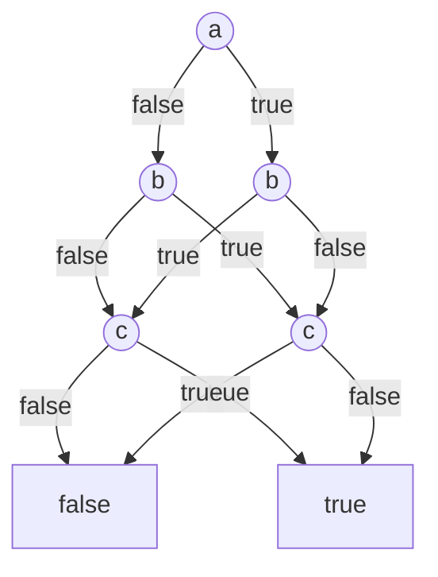

And this graph has a width of 4:

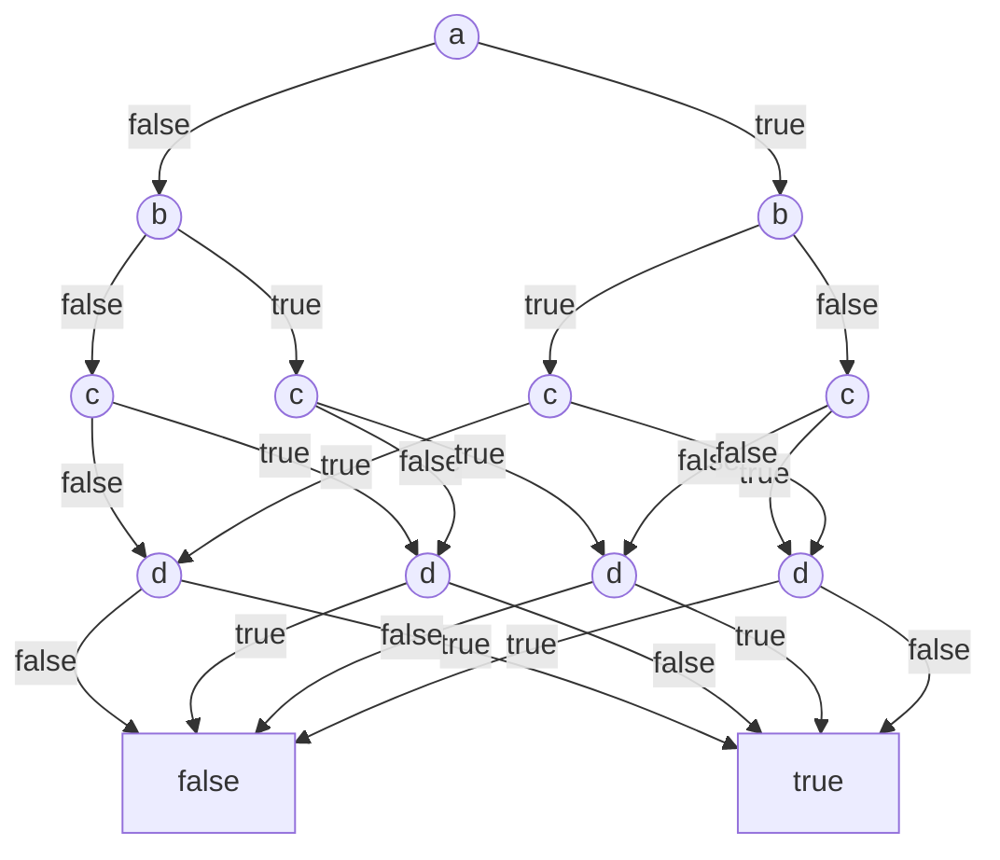

If you can limit the maximum allowed width of the OBDD, then the ROBDD and
equivalence algorithms can be computed in polynomial time. The primary way to do
this is the `2^k` restriction from above, where you limit how many state bits
are allowed to be carried forward from previous computations.

#### Negation Normal Forms (NNF)

"Negation normal form" is a circuit made of `and` and `or`, with `not` applied
only to input variables (not propositions). Thus, any expression written in NNF
requires those three operators (and, or, not).

"Decomposable NNF" (DNNF) is an NNF where the two sides of every `and` share no
inputs.

"Deterministic DNNF" (d-DNNF) is a DNNF where the two sides of any `or` cannot
both be true.

##### Exponential Blowup of DNNF

All of the NNF forms are expressively complete, meaning you can theoretically
generate any circuit from them. However, DNNF and d-DNNF have some situations in
which there is an exponential blowup of terms required to describe the equation.

Let's say you want to express "this 3×3 grid of boolean values has exactly one
true value in every row and every column." (That's called a _permutation
matrix_.) Call the cells `m11` through `m33`, by row and then column. In CNF,
that's:

```python
# Every row has a true cell.
(m11 or m12 or m13)
and (m21 or m22 or m23)
and (m31 or m32 or m33)
# No row has two true cells.
and (not m11 or not m12) and (not m11 or not m13) and (not m12 or not m13)
and ...  # the same for rows 2 and 3
# No column has two true cells.
and (not m11 or not m21) and (not m11 or not m31) and (not m21 or not m31)
and ...  # the same for columns 2 and 3
```

(Every column has a true cell automatically: there are three true cells, and no
two of them are in the same column.)

That's 21 clauses. The obvious way to write it in DNNF is one term for every way
to pick one cell in each row and column, with every cell in every term so that
no two sides of an `and` share an input:

```python
(
    m11 and not m12 and not m13
    and not m21 and m22 and not m23
    and not m31 and not m32 and m33
)
or (
    m11 and not m12 and not m13
    and not m21 and not m22 and m23
    and not m31 and m32 and not m33
)
or ...  # four more, one for each other way to pick the cells
```

For a grid with `n` rows and columns, the CNF has `n + n²(n − 1)` clauses, but
there are `n!` ways to pick the cells:

| `n` | CNF clauses | DNNF terms       |
| --- | ----------- | ---------------- |
| 3   | 21          | 6                |
| 5   | 105         | 120              |
| 8   | 456         | 40,320           |
| 10  | 910         | 3,628,800        |
| 20  | 7,620       | about 2.4 × 10¹⁸ |

A cleverer DNNF can be smaller than one term for each way to pick the cells, but
not by enough.
[Beame and Liew, "New Limits for Knowledge Compilation and Applications to Exact Model Counting"](https://arxiv.org/abs/1506.02639)
(UAI 2015) proved that every DNNF for this function grows exponentially with
`n`, no matter how it's written, while the CNF only grows with `n³`.

##### Exponential Blowup of d-DNNF

In d-DNNF, the requirement that the two sides of an `or` can never both be true
can make formulas exponentially larger than they are even in DNNF. Let's go
through an example to understand how this can happen.

Imagine you have a grid of boolean values with `n` rows and columns again, and
there are two checks you want to make against the grid:

- **Row check:** count the rows whose number of `true` cells is divisible by 3.
  Is that count odd?
- **Column check:** the same thing, for columns.

Each check is small by itself. For example, here's a row check for a 3×3 grid,
with cells `m11` through `m33` as before. A row of three cells has 0 or 3 true
cells exactly when all of its cells are equal. That can be expressed as "no two
neighboring cells differ." A simple logical formula for that check is:

```python
row1_good = not ((m11 ^ m12) or (m12 ^ m13))
row2_good = not ((m21 ^ m22) or (m22 ^ m23))
row3_good = not ((m31 ^ m32) or (m32 ^ m33))

row_check = row1_good ^ row2_good ^ row3_good
```

That's 3 logic gates per row, plus 2 logic gates to combine the rows, for a
total of 11 gates.

Fully written out into d-DNNF, that becomes:

```python
row1_good = (not m11 and not m12 and not m13) or (m11 and m12 and m13)
row1_bad = (
    (m11 and not m12)
    or (not m11 and m12)
    or (m11 and m12 and not m13)
    or (not m11 and not m12 and m13)
)
# ...the same for rows 2 and 3

rows23_odd = (row2_good and row3_bad) or (row2_bad and row3_good)
rows23_even = (row2_good and row3_good) or (row2_bad and row3_bad)
row_check = (row1_good and rows23_even) or (row1_bad and rows23_odd)
```

That's 51 gates. That's a huge blowup just to start with.

Now, imagine you want to express the whole equation:

```python
row_check or column_check
```

In DNNF, that's just `row_check or column_check`, exactly as written there,
because both sides of an `or` are allowed to be true. In d-DNNF, though, the two
sides can't both be true. The simple, high-level way to write it in d-DNNF is:

```python
row_check or (not row_check and column_check)
```

However, both sides of that `and` _also_ have to be written in d-DNNF. That gets
extremely complex (so complex that it's not really educational to write it all
out here). What matters is that expressing it requires exponentially more gates
in d-DNNF, even compared to DNNF:

| `n` | DNNF gates | d-DNNF gates |
| --- | ---------- | ------------ |
| 3   | 103        | 210          |
| 4   | 277        | 3,191        |
| 5   | 523        | 26,675       |
| 6   | 841        | 157,663      |
| 7   | 1,231      | 779,599      |
| 8   | 1,693      | 3,484,603    |

[Bova, Capelli, Mengel, and Slivovsky, "Knowledge Compilation Meets Communication Complexity"](https://www.ijcai.org/proceedings/2016/0147.pdf)
(IJCAI 2016) proved that every d-DNNF for this function grows exponentially with
`n`, no matter how it's written, while its DNNF only grows polynomially.

##### DNNF Cannot Be the Written Form of Expressions

As a result of the above, you can't force programmers to write all expressions
in DNNF or d-DNNF.

The other consequence is that DNNF and d-DNNF can require exponential time and
space to construct if you are converting expressions into those forms internally
in the compiler at compile time. That doesn't matter hugely for small numbers of
gates, but it can start to really matter at larger sizes.

##### What are the NNFs good for?

DNNF and d-DNNF are generally good when you need to do some expensive work on a
formula once, and then want to take a lot of cheap operations on it. For
example, satisfiability on both forms can be done in linear time (compared to
NP-complete for CNF). You can also do something called "model counting" (count
how many total satisfying assignments exist) on d-DNNF in linear time.

DNNF is not good for checking equivalence (the equivalence algorithm for two
DNNF formulas is coNP-complete). d-DNNF does have a randomized polynomial time
algorithm for comparing equivalence---however, it has a very low probability of
failing to detect that two equations are _different_ (that is, the error can be
"I said these are equivalent and they are not").

#### Algebraic Normal Form (ANF)

ANF is very similar to XAG in that it represents every Boolean function using
just `xor`, `and`, and `true`. However, ANF is required to be in a particular
canonical form: ANF must use AND for any operations on variables, and then
groups are combined using XOR:

```python
# Compact XAG
f = (a ^ b) & (c ^ d)

# Expanded ANF
f = (a & c) ^ (a & d) ^ (b & c) ^ (b & d)
```

Similar to DNNF, this ends up requiring an exponential expansion of terms. The
positive part of ANF is that it has a single canonical form, so doing
equivalence checks on it is a straightforward linear comparison.

#### Sentential Decision Diagrams (SDDs)

The term "sentential" means "relating to logical sentences."

A Sentential Decision Diagram is similar to a Binary Decision Diagram but can
represent certain Boolean functions exponentially more compactly. Where a BDD
makes decisions based on individual boolean variables, an SDD makes decisions
based on entire boolean formulas. Where a BDD node might ask the question "Is
`a` true?" a single SDD node could ask "Is `a and b` true?"

For example, consider this formula: `(a and b and c) or (not (a and b) and d)`.
You can express that much more simply as a decision:

```python
if a and b:
    result = c
else:
    result = d
```

An SDD represents those using "primes" (conditions) and "subs" (the result of
evaluating some condition). The above would translate into primes and subs like
this:

| Prime         | Sub |
| ------------- | --- |
| a and b       | c   |
| not (a and b) | d   |

And then the SDD graph looks like this:

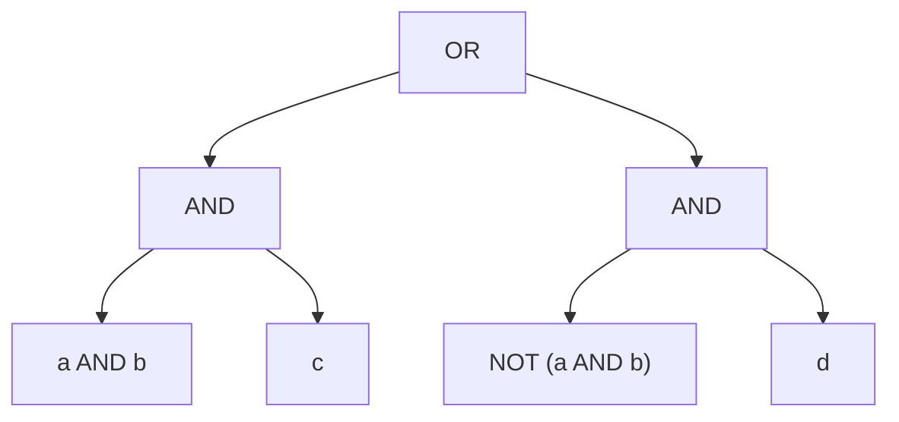

Within each node there are three rules:

1. **Exclusivity**: No two primes can be true simultaneously.
2. **Exhaustiveness**: At least one prime must always be true.
3. **Decomposability**: A prime and its corresponding sub cannot share
   variables.

##### The Variable Tree

Calculating an SDD involves first calculating a separate data structure called a
"Variable Tree" (vtree) that groups variables from the original expression. For
example, here's the vtree for our earlier example:

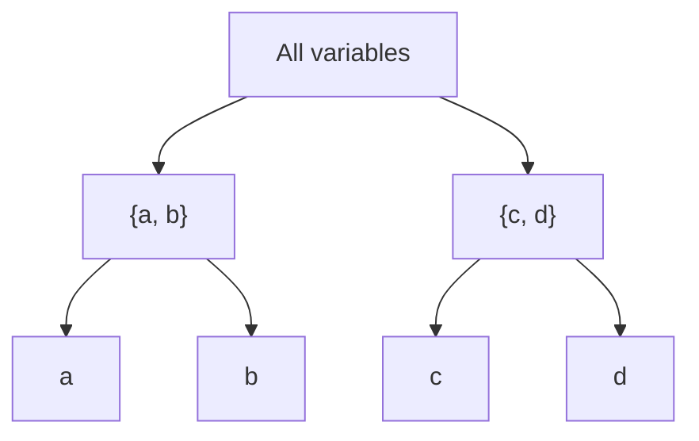

Splitting into `{a, b}` and `{c, d}` there is actually arbitrary; a vtree can be
built any way you want. However, often there are heuristics, like looking at how
variables are grouped in the original equation (which is what the above example
does).

The sole purpose of a vtree is to categorize the individual variables: the leaf
nodes at the lowest level of the tree. Everything that looked like a group
(`{a, b}` and `{c, d}`) in the above diagram is called an "internal node." They
exist only to create a tree that eventually gets down to the leaf nodes, which
contain single variable names.

Here's the trick: when we generate the SDD, every node that is a child on the
_left_ in the vtree must be a prime, and every node that is a child on the
_right_ must be a sub, in the SDD. In other words, the vtree says "you have to
restructure the equation this way in order to represent it." Thus, how you
choose to construct the vtree has a significant impact on the SDD's construction
cost. This is similar to BDD's "ordering" step, but with a hierarchical system
instead of just a linear order.

Calculating an optimal vtree exactly is an exponential time algorithm, but there
are heuristic algorithms for constructing likely-optimal vtrees.

##### Restrictions That Cause Optimal vtrees

Similarly to BDDs, you can dramatically improve the ability to construct optimal
vtrees (and thus optimal SDDs) by imposing restrictions on how later boolean
calculations depend on earlier ones. However, SDDs appear to give us a better
opportunity to constrain them via **bounded treewidth**.

To understand this, imagine we allowed any arbitrary boolean syntax, and we had
logic like this:

```python
x = a or b
y = b or c
z = c or d
w = d or e

result = x and y and z and w
```

The compiler then constructs something called a "primal graph:"

- Each Boolean input is a vertex.
- Two inputs are connected if they appear together in a constraint.

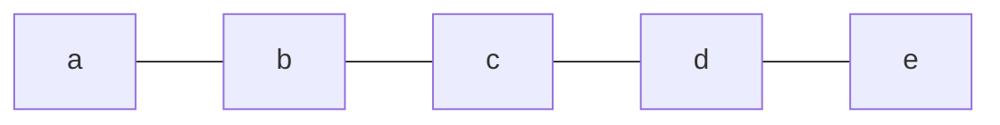

That graph has treewidth 1, regardless of how long the chain becomes.

Now consider this:

```python
result = (a or b or c) and (b or c or d) and (c or d or e)
```

It has a primal graph with treewidth 2:

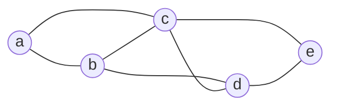

That looks like the rule is "there is at least one group in the equation that
depends on 2 variables from another group." However, consider this example:

```python
result = (a or b) and (b or c) and (c or a)
```

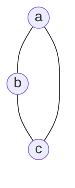

That has treewidth 2. It's really just a count of how many interconnected
variables must be considered together when resolving the equation.

This matters for the size of a "compressed" SDD (the "reduced" form of an SDD,
similar to an ROBDD). If you start from a CNF whose variables form a graph of
treewidth `k`, there's always a reduced SDD of size `O(n * 2^k)`, where `n` is
the number of variables. For a fixed `k`, that's linear: twice as many variables
means an SDD gets about twice as big.

OBDDs can't make that same promise. Some CNFs of treewidth `k` need an ROBDD of
at least about `n^(k/4)` nodes, no matter which variable order you pick. That's
a polynomial whose _degree_ grows with `k`.

So at treewidth `8`, a compressed SDD grows linearly with the number of
variables, while for some CNFs the best possible OBDD grows at least like `n²`.
Of course, in a real compiler, we would have to check how everything performs.

If we start with an AIG, the AIG's own graph is what the treewidth is measured
on, so the compiler doesn't need a separate dependency graph. However, checking
that the treewidth is at most `k` is still expensive in general: the linear-time
algorithm for a fixed `k` is too slow in practice (it contains a constant with
`k` in the exponent), so real tools use approximations or exact solvers that are
exponential in the worst case. For the small graphs inside one value operation,
an exact check might still be cheap in practice, though.

All that said, when starting with an AIG, the best proven bound on SDD size is
triple-exponential in `k`, too large to be a useful guarantee even for `k = 1`.
Nobody has yet proven that the generated SDDs actually _have_ to be that large,
however.

##### Relationship to Other Forms

This makes each node in an SDD look something like d-DNNF, but even stricter.
For example, `a and b` is valid d-DNNF, but not a valid SDD node, because an SDD
decision node requires an OR of prime/sub pairs whose primes form an exhaustive
partition. As an SDD node, it would have to look like
`(a and b) or (not a and False)`.

Overall, the relationship between forms looks like:

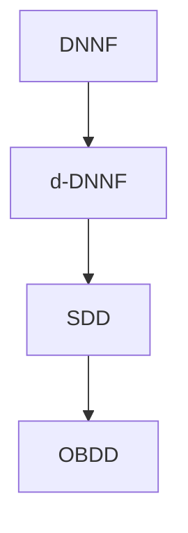

Every OBDD can be represented as an SDD, every SDD is a d-DNNF, and every d-DNNF
is a DNNF. The arrows represent increasing structural restrictions.

| Property                       | OBDD         | d-DNNF               | SDD            |
| ------------------------------ | ------------ | -------------------- | -------------- |
| Deterministic OR               | Yes          | Yes                  | Yes            |
| Decomposable AND               | Yes          | Yes                  | Yes            |
| Canonical representation       | Yes, reduced | No                   | Yes, reduced   |
| Polynomial-time model counting | Yes          | Yes                  | Yes            |
| Polynomial-time satisfiability | Yes          | Yes                  | Yes            |
| Polynomial-time equivalence    | Yes, reduced | randomized only      | Yes, reduced   |
| Polynomial-time Boolean Apply  | Yes          | No general guarantee | Yes, unreduced |

##### Power and Limitations of SDDs

Because SDD nodes require a form similar to d-DNNF, there is a similar cost for
writing them or converting to them from other forms. That said, there are
algorithms that make converting to SDDs efficient in common cases.

The primary advantage of SDDs is that they can be exponentially smaller than an
OBDD. An OBDD repeatedly checks conditions like:

```python
if a:
    ...
else:
    ...
```

But an SDD can instead check conditions like:

```python
if complex_condition(a, b, c):
    ...
elif another_condition(a, b, c):
    ...
else:
    ...
```

That lets SDD also exploit logical relationships between variables without
necessarily having to expand those relationships into a sequence of decisions
about individual variables.

It is still _possible_ for SDDs to blow up exponentially, but in common cases
they are smaller than OBDDs.

#### Everything is `if/then`

We could decide to make `if a then b else c` plus `not` into the only allowed
boolean operations. That makes us basically write something like a BDD directly
into source. We could impose ordering on how you write those if/then conditions
that forced programmers into a partially-canonical ordering:

1. Every if/then's condition is an input boolean, not a computed one.
2. The outputs can only be consumed by other such if/then clauses.
3. Enforce an ordering on how and when people interact with inputs so that
   if/then statements always happen in a predictable order.

## Solution

We define only two logical operations that the compiler knows about for boolean
values: `and` and `not`.

```define
define the logical_operation<standard:/boolean/and> {
    define the view<a> {
        it is read.
    }
    define the view<b> {
        it is read.
    }
    define the view<result> {
        it is written.
    }
}

define the logical_operation<standard:/boolean/not> {
    define the view<a> {
        it is read.
    }
    define the view<result> {
        it is written.
    }
}
```

This basically makes the written form of Define conditions into an And-Inverter
Graph (AIG) that can be read directly from the code.

Every other operation on boolean values is a composition of
`standard:/boolean/and` and `standard:/boolean/not`. For example, `a or b` is
`not (not a and not b)`.

The standard library can provide value operations for things like `or`, and the
compiler can choose to recognize them and use them as part of its optimizations
to speed up compilation or runtime performance.

### No Literals

No view of the logical operations `and` or `not` may look at a literal.

### Equality

There's no logical operation for the equality of boolean values. Instead,
equality is a value operation that is composed from `and` and `not`, just like
other boolean operations.

Boolean values are never equal to any other kind of value, at least not in any
way that's supported by the standard library. The programmer has to convert a
value to or from a boolean if they want to compare a boolean and something else.

## A Real Program

The below includes a few future operations in order to be able to write
interesting or useful programs.

### Value Qualities

```define
define the potential value<standard:/boolean> {
    it supports the logical_operation<standard:/boolean/and> {
        it may be read.
        it may be written.
    }
    it supports the logical_operation<standard:/boolean/not> {
        it may be read.
        it may be written.
    }
    it supports the logical_operation<standard:/number/less_than> {
        it may be written.
    }
}

define the potential value<standard:/number/natural> {
    it supports the logical_operation<standard:/number/less_than> {
        it may be read.
    }
}
```

### "Or" and Equality

The standard library could write these as value operations:

```define
define the operation<standard:/boolean/or> {
    define the view<a> {
        it is read.
        it may only contain particles where {
            it has the value<standard:/boolean>.
        }
    }
    define the view<b> {
        it is read.
        it may only contain particles where {
            it has the value<standard:/boolean>.
        }
    }
    define the view<result> {
        it is written.
        it may only contain particles where {
            it has the value<standard:/boolean>.
        }
    }

    it does {
        # a or b is not (not a and not b).
        define the view<not_a> {
            it may only contain particles where {
                it has the value<standard:/boolean>.
            }
        }
        execute the logical_operation<standard:/boolean/not> {
            with view<a> looking at view<a>.
            with view<result> looking at view<not_a>.
        }
        define the view<not_b> {
            it may only contain particles where {
                it has the value<standard:/boolean>.
            }
        }
        execute the logical_operation<standard:/boolean/not> {
            with view<a> looking at view<b>.
            with view<result> looking at view<not_b>.
        }
        define the view<neither> {
            it may only contain particles where {
                it has the value<standard:/boolean>.
            }
        }
        execute the logical_operation<standard:/boolean/and> {
            with view<a> looking at view<not_a>.
            with view<b> looking at view<not_b>.
            with view<result> looking at view<neither>.
        }
        execute the logical_operation<standard:/boolean/not> {
            with view<a> looking at view<neither>.
            with view<result> looking at view<result>.
        }
    }
}

define the operation<standard:/boolean/equality> {
    define the view<a> {
        it is read.
        it may only contain particles where {
            it has the value<standard:/boolean>.
        }
    }
    define the view<b> {
        it is read.
        it may only contain particles where {
            it has the value<standard:/boolean>.
        }
    }
    define the view<result> {
        it is written.
        it may only contain particles where {
            it has the value<standard:/boolean>.
        }
    }

    it does {
        # a and b are equal if they're both true or both false.
        define the view<both> {
            it may only contain particles where {
                it has the value<standard:/boolean>.
            }
        }
        execute the logical_operation<standard:/boolean/and> {
            with view<a> looking at view<a>.
            with view<b> looking at view<b>.
            with view<result> looking at view<both>.
        }
        define the view<not_a> {
            it may only contain particles where {
                it has the value<standard:/boolean>.
            }
        }
        execute the logical_operation<standard:/boolean/not> {
            with view<a> looking at view<a>.
            with view<result> looking at view<not_a>.
        }
        define the view<not_b> {
            it may only contain particles where {
                it has the value<standard:/boolean>.
            }
        }
        execute the logical_operation<standard:/boolean/not> {
            with view<a> looking at view<b>.
            with view<result> looking at view<not_b>.
        }
        define the view<neither> {
            it may only contain particles where {
                it has the value<standard:/boolean>.
            }
        }
        execute the logical_operation<standard:/boolean/and> {
            with view<a> looking at view<not_a>.
            with view<b> looking at view<not_b>.
            with view<result> looking at view<neither>.
        }
        execute the operation<standard:/boolean/or> {
            with view<a> looking at view<both>.
            with view<b> looking at view<neither>.
            with view<result> looking at view<result>.
        }
    }
}
```

### Combining Comparisons

```define
define the operation<standard:/number/natural/is_between> {
    define the view<value> {
        it is read.
        it may only contain particles where {
            it has the value<standard:/number/natural>.
        }
    }
    define the view<low> {
        it is read.
        it may only contain particles where {
            it has the value<standard:/number/natural>.
        }
    }
    define the view<high> {
        it is read.
        it may only contain particles where {
            it has the value<standard:/number/natural>.
        }
    }
    define the view<result> {
        it is written.
        it may only contain particles where {
            it has the value<standard:/boolean>.
        }
    }

    it does {
        # view<result> is whether view<value> is strictly between view<low>
        # and view<high>.
        define the view<below_high> {
            it may only contain particles where {
                it has the value<standard:/boolean>.
            }
        }
        execute the logical_operation<standard:/number/less_than> {
            with view<a> looking at view<value>.
            with view<b> looking at view<high>.
            with view<result> looking at view<below_high>.
        }
        define the view<above_low> {
            it may only contain particles where {
                it has the value<standard:/boolean>.
            }
        }
        execute the logical_operation<standard:/number/less_than> {
            with view<a> looking at view<low>.
            with view<b> looking at view<value>.
            with view<result> looking at view<above_low>.
        }
        execute the logical_operation<standard:/boolean/and> {
            with view<a> looking at view<below_high>.
            with view<b> looking at view<above_low>.
            with view<result> looking at view<result>.
        }
    }
}
```

## Why This is the Right Solution

### Why `and` and `not`?

We need some minimum set in order to be able to enforce Define's "there is only
one way to do it" rule, and also to make it easy to reason about all boolean
logic in a consistent way in the compiler.

There are basically only a few realistic options for a minimum set:

- NAND or NOR (the universal logic gates)
- `and` and `not` or `or` and `not` (an AIG or OIG)
- `xor`, `and`, and `true` --- Algebraic Normal Form (ANF) or Xor-And Graph
  (XAG). Also variants with `or` instead of `and` work the same way.
- `and`, `or`, and `not` (supporting something like DNNF or something that more
  directly translates into an SDD)

Analysis of all the options in the Problems came back, over and over, to an AIG
being the most efficient _basic_ representation for all boolean logic. NAND/NOR
are not associative, which means we can't re-order them cleanly for efficiency
or for easily forcing some canonical order (a future proposal). A DNNF and
d-DNNF explicitly _can't_ be the written form of boolean logic, because some
DNNF forms require an exponential number of terms to express their logic.
Without DNNF, there's no reason to allow `or` because it can be written with
`and` and `not`.

We choose an AIG over an XAG because normal computer programs just don't write
`xor` that often. You're much more likely to be parsing out AND/NOT/OR.

There are other forms that obviously can't be used, like BDD/SDD (like just
forcing people to write out some tree-like structure by hand) because they have
similar exponential expansion issues as DNNF. The bounded state principles are
still useful for us, though---we might use them (in a future proposal, probably)
to place restrictions on Define code that improve our ability to compile it
quickly.

With `and` and `not`, a program is already written in the form the compiler
reasons in, making compilation simpler and faster.

The cost is that compositions are longer than they would be with more logical
operations. "Or" is four statements, and equality is five, once it can use "or."
Programs don't have to write those out every time, though, because they can use
the standard library substitutions.

The compiler can convert the AIG to a BDD, SDD, DNNF, MIG, ANF, or whatever it
needs to. It's actually the simplest form to translate.

### Why No Literals?

This is just a "there is only one way to do it" rule. If you let people write
`true` as one of the views of `and`, that just returns the other value (you
never need that) and if it's `false` then the whole computation is just a
literal `false`.

A literal in `standard:/boolean/and` is either a second way to write its other
value (with true) or a constant (with false), and a literal in
`standard:/boolean/not` is a second way to write the other literal. Forbidding
literals leaves one way to write each.

## Forward Compatibility

AIGs can be translated into any other representation of boolean logic, so we can
easily change our minds later if we want to.

## Refactoring Existing Systems

AIGs can provably express any boolean logic, so this poses no barrier to
refactoring programs.
