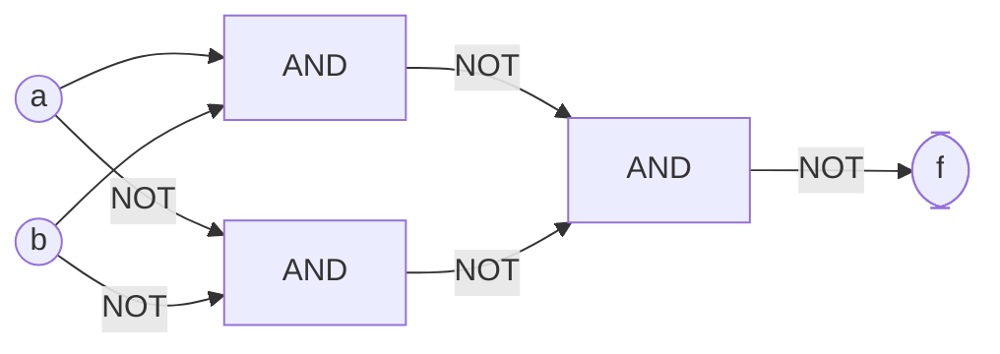
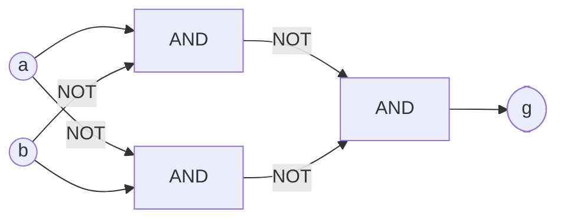
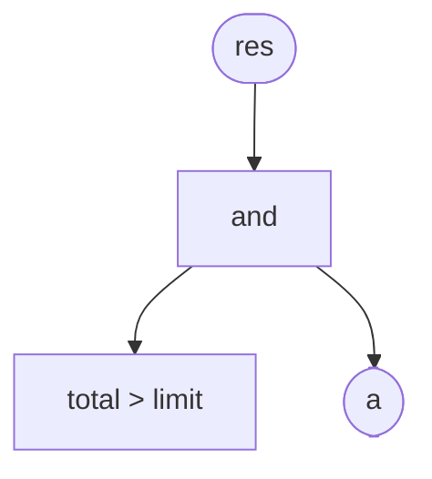

# Define Language Proposal 59: No Redundant Boolean Logic

- **Author:** Max Kanat-Alexander
- **Status:** Draft
- **Date Proposed:** November 24, 2026
- **Date Finalized:**

## Problems

> Note: For some of the background research behind this proposal, see
> [Representations of Boolean Logic](background/boolean-logic-representations.md).

One of our aspirations with Define is to enforce, to whatever degree possible,
that there is only one way to write any given program.

This was actually one of the core reasons for writing
[DLP 56 (Logical Operations for Boolean Values)](00056-logical-operations-for-boolean-values.md),
where we defined the minimal core operations. That's the first logical step
required, here: know what the core operations are.

However, even with just `and` and `not`, it's still possible to write the same
logic in many different ways. Plus, it's unnatural to force programs to be
_directly_ written entirely with `and` and `not`. You do want to have
higher-level constructs like `or`, `xor`, `implies`, etc., which we allow as
Value Operations. Once we allow those, though, you open up the opportunity for
there to be even _more_ ways to write the same logic.

In order to accomplish our "one way to write it" goal, we have to have some
deterministic way to force all programs to have the same "shape" for boolean
logic at the source code level.

This involves solving multiple high-level problems that will be spread across
multiple DLPs. This proposal covers the first and simplest problem: preventing
the expression of redundant boolean logic (essentially, totally unnecessary
parts of a boolean expression that provide no additional logical value because
they duplicate another test in the same expression).

This itself splits into a few different problems.

### 1: Literals in Boolean Expressions

In the expression `a and True` or `a or False`, the literal boolean values are
redundant. This is already solved for logical operations in
[DLP 55 (Logical Operations)](00055-logical-operations.md).

However, Value Operations (including those called within an Operation Statements
Block) could still be passed a literal boolean. You could have an `xor` Value
Operation that gets passed `a` and `true`, which would just be a confusing way
to calculate `not a`.

### 2: Purely Redundant Terms

It is possible to write logical statements inside of a boolean expression that
provide no value at all, just purely redundant statements. For example:

- `not (not a)` is just `a`.
- `a and (a or b)` is just `a`.

### 3: Constant Expressions

It's possible to write statements that are always true (tautologies) or always
false (contradictions). For example:

- `a and not a` is always false.
- `a or not a` is always true.

### 4: Useless Variables

Doing something like `a and (a or b)` simply computes `a`, a value the program
already knows. That makes reading `b` there useless. If nothing else reads `b`,
then `b` is dead code.

Inside of a Value Operation, that _specific_ example would already be handled by
solving the problems above, along with our Single Assignment and normal dead
code rules: once we eliminated the `and (a or b)` term from that equation
(because it's redundant) then `b` would obviously be dead code.

However, there are situations in which our pre-existing rules would _not_ handle
this "useless variable" problem. For example, imagine this expression:

```python
(a and b and c) or (a and (not b) and c)
```

That is actually just a very long way of expressing `a and c`, and yet no
_individual_ term in it is redundant or constant:

| Value                   | Same as an earlier value?       | Constant? |
| ----------------------- | ------------------------------- | --------- |
| `a and b`               | No                              | No        |
| `(a and b) and c`       | No                              | No        |
| `not b`                 | No                              | No        |
| `a and (not b)`         | No                              | No        |
| `(a and (not b)) and c` | No                              | No        |
| the `or` of the two     | No: `a and c` is never computed | No        |

Thus, we need to explicitly care about useless variables.

### 5: The Same Value With a Different Structure

One might believe that you could just convert everything into an AIG, as
discussed in
[DLP 56 (Logical Operations for Boolean Values)](00056-logical-operations-for-boolean-values.md),
and then compare the structure of two AIGs to find duplicates. Unfortunately,
the exact same logic can be written with very different AIG structures.

For example, the following both compute whether `a` and `b` are equal.

```python
(a and b) or (not a and not b)
```

AIG:



```python
not ((a and not b) or (not a and b))
```

AIG:



You can see that the `NOT` edges and the final `NOT` on the output of those two
AIGs are different, even though the two expressions are logically equivalent.

### 6: Multiple Results From One Execution

A Value Operation can write more than one view. For example, a numeric operation
can write both a quotient and a remainder, or a result and a status flag.

For pure boolean logic, however, writing multiple views from one execution
breaks redundancy checking. For example, imagine you had a function like this:

```python
def half_add(a: bool, b: bool) -> tuple[bool, bool]:
    return (a and b, a != b)


def caller(x: bool, y: bool, z: bool) -> bool:
    x_or_y = x or y
    # `carry` is `x and (x or y)`, which is always just `x` (redundant),
    # while `total` is `(not x) and y` (not redundant).
    carry, total = half_add(x, x_or_y)
    return (carry and z) or total
```

Here `carry` is always the same as `x`, so the compiler reports `carry` as a
redundant value and tells the programmer to use `x` instead. If the programmer
changes the last line to `return (x and z) or total`, then `carry` becomes
unused dead code. However, `caller` cannot remove the call to `half_add` because
it still needs `total`.

There is no way to fix `caller` without splitting `half_add` apart. What if
`half_add` came from some library that you have no control over and was the only
way to accomplish what you need? Uh oh.

### 7: Value Operations That Mix Booleans and Other Values

When a Value Operation works on both booleans and non-boolean values (like
numbers), four different problems can occur.

#### Pure Boolean Results Alongside Other Values

The same issues from Problem 6 show up if a Value Operation computes non-boolean
values and also writes a boolean output view whose value depends only on boolean
input views:

```python
def add_and_check(x: int, y: int, a: bool, b: bool) -> tuple[int, bool]:
    return (x + y, a and b)


def caller(x: int, y: int, p: bool, q: bool) -> bool:
    p_or_q = p or q
    # `both` is `p and (p or q)`, which is always just `p` (redundant),
    # while `total` is `x + y` (needed for `total < 10`).
    total, both = add_and_check(x, y, p, p_or_q)
    return both and (total < 10)
```

There, `add_and_check` does some addition _and_ returns a boolean that's based
only on boolean inputs. In `caller`, `both` is always just `p`, so `q` and
`p_or_q` are completely useless. That leaves the compiler with two bad options:

1. The compiler checks `both` in `caller` and tells the programmer to use `p`
   instead (`return p and (total < 10)`). Then `both` becomes unused dead code,
   but `caller` cannot remove `add_and_check`, because `caller` needs `total`.
2. The compiler does not analyze `both` inside `add_and_check` when checking
   `caller`. Then `caller` compiles with a useless variable `q` and a redundant
   computation `p and (p or q)`, turning such Value Operations into a loophole
   around this proposal.

#### Boolean Inputs Mixed Into Non-Boolean Results

Even when a boolean output view _does_ depend on non-boolean work, combining a
boolean input view into that result creates the same loophole:

```python
def add_and_gate(x: int, y: int, limit: int, a: bool) -> tuple[int, bool]:
    total = x + y
    return (total, (total > limit) and a)


def caller(x: int, y: int, limit: int, p: bool) -> bool:
    total, res = add_and_gate(x, y, limit, p)
    # Redundant: `res` already ANDed `p`, so `res and p` is always just `res`.
    return res and p
```

In `caller`, `add_and_gate` already computes `res = (total > limit) and p`. Then
`caller` writes `res and p`, which is `((total > limit) and p) and p` — it
checks `and p` twice, so `res and p` is always the exact same value as `res`.

To catch that redundant `and p`, the compiler would have to track boolean
dependencies through Value Operations that also compute non-boolean values;
otherwise, the redundant `and p` in `caller` slips past unchecked.

#### Correlated Boolean Results

A Value Operation that computes non-boolean values can also enable boolean
redundancy when two of its boolean output views are directly derived from the
same non-boolean comparison, with only boolean operations coming after that
non-boolean operation:

```python
def compare(x: int, y: int) -> tuple[bool, bool]:
    lt = x < y
    return (lt, not lt)


def caller(x: int, y: int) -> bool:
    lt, not_lt = compare(x, y)
    # Always false, yet `lt` and `not_lt` look like independent boolean inputs.
    return lt and not_lt
```

Inside `compare`, both output views depend on `x < y`, and neither view depends
on any boolean input view. Yet unless the compiler tracks how `compare`'s two
boolean results relate to each other when checking `caller`, `lt and not_lt`
looks valid even though it is always `false`.

You could also make redundancies that the compiler can't see (`not lt` would be
the same as `not_lt`) or useless variables that it can't see
(`(lt and a and b) or (not_lt and a and b)` is always just `a and b`).

#### Useless Variables in One Expression

In a Value Operation that mixes booleans and non-boolean values, boolean logic
can feed into multiple non-boolean operations. That lets a boolean variable be
completely useless inside one boolean expression while still changing the Value
Operation's final result through another operation:

```python
def caller(a: bool, b: bool, c: bool, x: int, y: int) -> int:
    # `cond` is always `a == c` — `b` cancels out completely.
    a_eq_b = a == b
    b_eq_c = b == c
    cond = a_eq_b == b_eq_c

    first = select(cond, x, y)  # `b` can never change `cond`
    second = select(b, first, 0)  # `b` still changes `caller`'s return value
    return second
```

In that code, none of `a_eq_b`, `b_eq_c`, or `cond` are redundant or constant,
and changing `b` _does_ change the return value (because `second` reads `b`). If
the compiler only checked whether changing `b` can change `caller`'s overall
result, it would miss that `b` is completely useless inside `cond`.

#### Independent Non-Boolean Results

It is worth noting that a Value Operation can still write boolean output views
that depend on distinct non-boolean work without any of these problems:

```python
def add_with_overflow(x: int, y: int, limit: int) -> tuple[int, bool]:
    total = x + y
    overflowed = total > limit
    return (total, overflowed)
```

Here, `overflowed` comes from a _numeric_ operation, does not depend on any
boolean input view, and does not share a non-boolean comparison with any other
boolean output view. There's no danger caused around boolean logic redundancy.

## Solution

First, we must define a few new terms.

### Terminology

A **boolean view** is any view (interface or local) that has the value quality
`value<standard:/boolean>`.

A **Boolean Value Operation** is a value operation where:

- Every view is a boolean view.
- Every statement in the Operation Statements Block is either (1) an execution
  of a `standard:/boolean` logical operation, (2) an execution of another
  Boolean Value Operation, (3) a View Setting Statement, or (4) a Local View
  Definition that defines a view with the value quality
  `value<standard:/boolean>`.

A **Boolean Abstract Operation** is a logical operation allowed for
`value<standard:/boolean>` or a Boolean Value Operation.

A **Boolean Statement** is an execution of a Boolean Abstract Operation.

Within a Value Operation's Operation Statements Block, a **boolean input** is
either:

- a boolean input view of the Value Operation itself, or
- a boolean view written by a statement that executes a non-Boolean Abstract
  Operation.

#### Boolean Sources

One term requires a bit more explanation.

1. Imagine you have a boolean view. Let's call this our "analyzed view."
2. If the analyzed view is an input view of this Value Operation that still has
   its initial value, stop.
3. Find the statement that set the value of the analyzed view.
4. If the statement executes a non-Boolean Abstract Operation, stop at the
   analyzed view.
5. If the statement is a Boolean Statement or a View Setting Statement, look at
   every input view of that statement, and treat each of those arguments as a
   new analyzed view.

Each view on which you stop is one of the **Boolean Sources** of the initial
analyzed view.

For example, in `res = (total > limit) and a`, walking backward from `res`
branches through `and` into both of its arguments:



We stop at `total > limit`, because it's not a Boolean Statement or a View
Setting Statement. So `res`'s Boolean Sources are `{total > limit, a}`.

### High-Level Rules

Value Operations may not contain boolean logic that has:

- A purely redundant Boolean Statement.
- A constant Boolean Statement.
- A useless boolean input.

The compiler will also, in a future proposal, apply these rules to boolean logic
executed through Boolean Value Operations called by actions. This proposal at
this time, however, only covers logic inside of a Value Operation's Operation
Statements Block.

In order to implement all of this efficiently, there are other rules we have to
enforce as well, and a fair bit of detail to go into about each of the above
rules, as well.

### Boolean Value Operations Have Only One Output View

A Boolean Value Operation must have exactly one output view. The compiler will
reject any Value Operation that violates this rule.

### Useless Boolean Inputs

No boolean input may be a useless variable in expressed boolean logic.

Stated positively: for every boolean output view of a Value Operation and every
boolean argument given to a statement that isn't a Boolean Statement, changing
any view's value in that view's Boolean Sources must be able to change its
value.

Note that dead Boolean Statements and unread boolean input views are also
(already) forbidden by Single Assignment (DLP 55), which requires every input
view and local view to be read.

### Constant Boolean Statements

In any Value Operation, a Boolean Statement is **constant** when its output view
always evaluates to the same value, regardless of the values set in that output
view's Boolean Sources.

Constant Boolean Statements are forbidden---the compiler will throw an error if
it discovers one.

### Purely Redundant Boolean Statements

In any Value Operation, a Boolean Statement is **purely redundant** when its
output view always has the same value as, or always has the opposite value of,
either:

- one boolean input, or
- the output view of one earlier Boolean Statement.

When we say "always has the same value as," we mean for every possible
combination of values of the Value Operation's boolean inputs. That includes
boolean input combinations that other logic looks like it forbids. (For example,
if the code checks `x < 3` and `x < 5`, we would still check the possibility
that one of those is true and the other is false.)

One exception: a `logical_operation<standard:/boolean/not>` statement is never
purely redundant just because its output view has the opposite value of a
boolean input or of the output view of an earlier Boolean Statement. (Obviously,
that's what `not` is for.)

The compiler throws an error if it discovers any purely redundant Boolean
Statement.

#### Redundancy Tracks Through View Setting Statements

A value copied with a View Setting Statement is, of course, identical to the
value it was copied from, so `a and copy_of_a` is also a redundant value: it's
always the same as `a`.

### No Boolean Literals in Abstract Operations

No execution of an Abstract Operation, anywhere in a program, may look at a
boolean literal or at a position whose current particle is known to contain a
boolean literal (either set from a literal directly, set through a chain of
Value Setting Statements in the same Action Statements Block, or produced by a
callee via its contract per [DLP 53 (Unset Values)](00053-unset-values.md)).

### Boolean Output Views in Non-Boolean Value Operations

In a Value Operation that is not a Boolean Value Operation, every boolean output
view (an output view with `value<standard:/boolean>`) must follow two rules.

#### 1. No Boolean Input View Among the Boolean Sources

A boolean output view's Boolean Sources must never include a boolean input view
of the Value Operation. For example, if there was a whole Value Operation whose
logic looked like `res = (total > limit) and a`, `a` would be a boolean input
view, so `res` would be violating this rule.

To clarify, this also forbids any situation in which a boolean output view is
the result solely of Boolean Statements and View Setting Statements in a
non-Boolean Value Operation. Pure boolean results belong in a Boolean Value
Operation.

#### 2. No Shared Boolean Source Across Boolean Output Views

Two different boolean output views of the same Value Operation must never have
any Boolean Source in common.

Note that within an Operation Statements Block, if a single executed non-Boolean
Value Operation writes two different boolean output views (for example, a
numeric operation that reports both whether a result overflowed and whether it
is zero) each of those output views is its own Boolean Source, so forwarding
each one to a different boolean output view is allowed.

## A Real Program

A lamp that's controlled by two switches is lit when either switch is on and the
power is on.

```define
define the operation<mv:example.com:logic:/lamp/is_lit> {
    define the view<switch_a> {
        it is read.
        it may only contain particles where {
            it has the value<standard:/boolean>.
        }
    }
    define the view<switch_b> {
        it is read.
        it may only contain particles where {
            it has the value<standard:/boolean>.
        }
    }
    define the view<power> {
        it is read.
        it may only contain particles where {
            it has the value<standard:/boolean>.
        }
    }
    define the view<lit> {
        it is written.
        it may only contain particles where {
            it has the value<standard:/boolean>.
        }
    }

    it does {
        define the view<either> {
            it may only contain particles where {
                it has the value<standard:/boolean>.
            }
        }
        execute the operation<standard:/boolean/or> {
            with view<a> looking at view<switch_a>.
            with view<b> looking at view<switch_b>.
            with view<result> looking at view<either>.
        }
        execute the logical_operation<standard:/boolean/and> {
            with view<a> looking at view<power>.
            with view<b> looking at view<either>.
            with view<result> looking at view<lit>.
        }
    }
}
```

That's a valid program with none of the issues described in this proposal.

### Errors

#### More Than One Output View

This Boolean Value Operation defines two output views, `view<both>` and
`view<either>`:

```define
define the operation<mv:example.com:logic:/bad_two_views> {
    define the view<a> {
        it is read.
        it may only contain particles where {
            it has the value<standard:/boolean>.
        }
    }
    define the view<b> {
        it is read.
        it may only contain particles where {
            it has the value<standard:/boolean>.
        }
    }
    define the view<both> {
        it is written.
        it may only contain particles where {
            it has the value<standard:/boolean>.
        }
    }
    # Error: a Boolean Value Operation may have only one output view.
    define the view<either> {
        it is written.
        it may only contain particles where {
            it has the value<standard:/boolean>.
        }
    }

    it does {
        execute the logical_operation<standard:/boolean/and> {
            with view<a> looking at view<a>.
            with view<b> looking at view<b>.
            with view<result> looking at view<both>.
        }
        execute the operation<standard:/boolean/or> {
            with view<a> looking at view<a>.
            with view<b> looking at view<b>.
            with view<result> looking at view<either>.
        }
    }
}
```

#### Boolean Output Views in Non-Boolean Value Operations

Here `view<result>` combines a numeric comparison with boolean input view
`view<a>`:

```define
define the operation<mv:example.com:logic:/bad_mixed_boolean_input> {
    define the view<x> {
        it is read.
        it may only contain particles where {
            it has the value<standard:/number/integer>.
        }
    }
    define the view<y> {
        it is read.
        it may only contain particles where {
            it has the value<standard:/number/integer>.
        }
    }
    define the view<a> {
        it is read.
        it may only contain particles where {
            it has the value<standard:/boolean>.
        }
    }
    # Error: view<result>'s Boolean Sources include boolean input view<a>.
    define the view<result> {
        it is written.
        it may only contain particles where {
            it has the value<standard:/boolean>.
        }
    }

    it does {
        define the view<lt> {
            it may only contain particles where {
                it has the value<standard:/boolean>.
            }
        }
        execute the logical_operation<standard:/number/less_than> {
            with view<a> looking at view<x>.
            with view<b> looking at view<y>.
            with view<result> looking at view<lt>.
        }
        execute the logical_operation<standard:/boolean/and> {
            with view<a> looking at view<a>.
            with view<b> looking at view<lt>.
            with view<result> looking at view<result>.
        }
    }
}
```

Here `view<lt>` and `view<not_lt>` are both boolean output views that share
`view<lt>` as a Boolean Source:

```define
define the operation<mv:example.com:logic:/bad_correlated_outputs> {
    define the view<x> {
        it is read.
        it may only contain particles where {
            it has the value<standard:/number/integer>.
        }
    }
    define the view<y> {
        it is read.
        it may only contain particles where {
            it has the value<standard:/number/integer>.
        }
    }
    define the view<lt> {
        it is written.
        it may only contain particles where {
            it has the value<standard:/boolean>.
        }
    }
    # Error: view<lt> and view<not_lt> share view<lt> as a Boolean Source.
    define the view<not_lt> {
        it is written.
        it may only contain particles where {
            it has the value<standard:/boolean>.
        }
    }

    it does {
        execute the logical_operation<standard:/number/less_than> {
            with view<a> looking at view<x>.
            with view<b> looking at view<y>.
            with view<result> looking at view<lt>.
        }
        execute the logical_operation<standard:/boolean/not> {
            with view<a> looking at view<lt>.
            with view<result> looking at view<not_lt>.
        }
    }
}
```

#### Useless Boolean Input

Here `view<result>` computes `(a == b) == (b == c)`, so `view<b>` cancels out
and never affects `view<result>`:

```define
define the operation<mv:example.com:logic:/bad_useless_input> {
    define the view<a> {
        it is read.
        it may only contain particles where {
            it has the value<standard:/boolean>.
        }
    }
    # Error: view<b> can never change view<result> (which is always whether
    # view<a> and view<c> are equal).
    define the view<b> {
        it is read.
        it may only contain particles where {
            it has the value<standard:/boolean>.
        }
    }
    define the view<c> {
        it is read.
        it may only contain particles where {
            it has the value<standard:/boolean>.
        }
    }
    define the view<result> {
        it is written.
        it may only contain particles where {
            it has the value<standard:/boolean>.
        }
    }

    it does {
        define the view<a_eq_b> {
            it may only contain particles where {
                it has the value<standard:/boolean>.
            }
        }
        execute the operation<standard:/boolean/equal> {
            with view<a> looking at view<a>.
            with view<b> looking at view<b>.
            with view<result> looking at view<a_eq_b>.
        }
        define the view<b_eq_c> {
            it may only contain particles where {
                it has the value<standard:/boolean>.
            }
        }
        execute the operation<standard:/boolean/equal> {
            with view<a> looking at view<b>.
            with view<b> looking at view<c>.
            with view<result> looking at view<b_eq_c>.
        }
        execute the operation<standard:/boolean/equal> {
            with view<a> looking at view<a_eq_b>.
            with view<b> looking at view<b_eq_c>.
            with view<result> looking at view<result>.
        }
    }
}
```

Here `view<b>` is still read by the second `select`, but it cancels out of
`view<cond>` in the first `select`:

```define
define the operation<mv:example.com:logic:/bad_useless_input_in_one_expression> {
    define the view<a> {
        it is read.
        it may only contain particles where {
            it has the value<standard:/boolean>.
        }
    }
    define the view<b> {
        it is read.
        it may only contain particles where {
            it has the value<standard:/boolean>.
        }
    }
    define the view<c> {
        it is read.
        it may only contain particles where {
            it has the value<standard:/boolean>.
        }
    }
    define the view<x> {
        it is read.
        it may only contain particles where {
            it has the value<standard:/number/integer>.
        }
    }
    define the view<y> {
        it is read.
        it may only contain particles where {
            it has the value<standard:/number/integer>.
        }
    }
    define the view<result> {
        it is written.
        it may only contain particles where {
            it has the value<standard:/number/integer>.
        }
    }

    it does {
        define the view<a_eq_b> {
            it may only contain particles where {
                it has the value<standard:/boolean>.
            }
        }
        execute the operation<standard:/boolean/equal> {
            with view<a> looking at view<a>.
            with view<b> looking at view<b>.
            with view<result> looking at view<a_eq_b>.
        }
        define the view<b_eq_c> {
            it may only contain particles where {
                it has the value<standard:/boolean>.
            }
        }
        execute the operation<standard:/boolean/equal> {
            with view<a> looking at view<b>.
            with view<b> looking at view<c>.
            with view<result> looking at view<b_eq_c>.
        }
        define the view<cond> {
            it may only contain particles where {
                it has the value<standard:/boolean>.
            }
        }
        execute the operation<standard:/boolean/equal> {
            with view<a> looking at view<a_eq_b>.
            with view<b> looking at view<b_eq_c>.
            with view<result> looking at view<cond>.
        }
        define the view<first> {
            it may only contain particles where {
                it has the value<standard:/number/integer>.
            }
        }
        # Error: view<b> is in view<cond>'s Boolean Sources, but view<b> can
        # never change view<cond> (which is always whether view<a> and view<c>
        # are equal).
        execute the operation<standard:/number/integer/select> {
            with view<condition> looking at view<cond>.
            with view<if_true> looking at view<x>.
            with view<if_false> looking at view<y>.
            with view<result> looking at view<first>.
        }
        execute the operation<standard:/number/integer/select> {
            with view<condition> looking at view<b>.
            with view<if_true> looking at view<first>.
            with view<if_false> looking at literal<standard:/number/integer>"0".
            with view<result> looking at view<result>.
        }
    }
}
```

#### Constant Boolean Statement

Here `view<result>` computes `a and not a`, which is always `false`:

```define
define the operation<mv:example.com:logic:/bad_constant> {
    define the view<a> {
        it is read.
        it may only contain particles where {
            it has the value<standard:/boolean>.
        }
    }
    define the view<result> {
        it is written.
        it may only contain particles where {
            it has the value<standard:/boolean>.
        }
    }

    it does {
        define the view<not_a> {
            it may only contain particles where {
                it has the value<standard:/boolean>.
            }
        }
        execute the logical_operation<standard:/boolean/not> {
            with view<a> looking at view<a>.
            with view<result> looking at view<not_a>.
        }
        # Error: view<result> is always false.
        execute the logical_operation<standard:/boolean/and> {
            with view<a> looking at view<a>.
            with view<b> looking at view<not_a>.
            with view<result> looking at view<result>.
        }
    }
}
```

#### Purely Redundant Boolean Statement

Here `view<result>` computes `not (not a)`, which is always the same as
`view<a>`:

```define
define the operation<mv:example.com:logic:/bad_redundant> {
    define the view<a> {
        it is read.
        it may only contain particles where {
            it has the value<standard:/boolean>.
        }
    }
    define the view<result> {
        it is written.
        it may only contain particles where {
            it has the value<standard:/boolean>.
        }
    }

    it does {
        define the view<not_a> {
            it may only contain particles where {
                it has the value<standard:/boolean>.
            }
        }
        execute the logical_operation<standard:/boolean/not> {
            with view<a> looking at view<a>.
            with view<result> looking at view<not_a>.
        }
        # Error: view<result> is always the same as view<a>.
        execute the logical_operation<standard:/boolean/not> {
            with view<a> looking at view<not_a>.
            with view<result> looking at view<result>.
        }
    }
}
```

Here `view<copy_of_a>` is copied from `view<a>`, so `a and copy_of_a` is always
the same as `view<a>`:

```define
define the operation<mv:example.com:logic:/bad_copy_redundant> {
    define the view<a> {
        it is read.
        it may only contain particles where {
            it has the value<standard:/boolean>.
        }
    }
    define the view<result> {
        it is written.
        it may only contain particles where {
            it has the value<standard:/boolean>.
        }
    }

    it does {
        define the view<copy_of_a> {
            it may only contain particles where {
                it has the value<standard:/boolean>.
            }
        }
        set the value of view<copy_of_a> from view<a>.
        # Error: view<result> is always the same as view<a>.
        execute the logical_operation<standard:/boolean/and> {
            with view<a> looking at view<a>.
            with view<b> looking at view<copy_of_a>.
            with view<result> looking at view<result>.
        }
    }
}
```

#### Boolean Literals in Abstract Operations

Here `or` looks directly at `literal<standard:/boolean>"true"`:

```define
define the operation<mv:example.com:logic:/bad_literal> {
    define the view<a> {
        it is read.
        it may only contain particles where {
            it has the value<standard:/boolean>.
        }
    }
    define the view<result> {
        it is written.
        it may only contain particles where {
            it has the value<standard:/boolean>.
        }
    }

    it does {
        # Error: an Abstract Operation may not look at a boolean literal.
        execute the operation<standard:/boolean/or> {
            with view<a> looking at view<a>.
            with view<b> looking at literal<standard:/boolean>"true".
            with view<result> looking at view<result>.
        }
    }
}
```

Here `position<flag>` was set from a boolean literal earlier in the same action:

```define
define the potential action<mv:example.com:logic:/bad_literal_in_action> {
    define the position<input> {
        it may only contain particles where {
            it has the value<standard:/boolean>.
        }
    }
    define the position<result> {
        it may only contain particles where {
            it has the value<standard:/boolean>.
        }
    }

    it happens when {
        the position<input> has a particle.
    } and it does {
        define the position<flag> {
            it may only contain particles where {
                it has the value<standard:/boolean>.
            }
        }
        create a particle in position<flag>.
        set the value of position<flag> from literal<standard:/boolean>"true".
        create a particle in position<result>.
        # Error: position<flag> is known to contain a boolean literal.
        execute the operation<standard:/boolean/or> {
            with view<a> looking at position<input>.
            with view<b> looking at position<flag>.
            with view<result> looking at position<result>.
        }
    }
}
```

## Why This is the Right Solution

A ton of research went into this, and there was a LOT of back and forth on
different decisions, here. If you really want to dig through a bunch of vaguely
unreadable AI slop, you can see all of the
[experiments and research](https://github.com/define-lang/research/tree/main/boolean_equality_checking)
that went into this and the other following DLPs on boolean logic reduction.

One of the most important things to realize is that Value Operations are not
meant for general-purpose programming. They are meant entirely and only as a
sort of system to specify behavior that happens outside the universe of the
program---symbolic operations that occur in another universe. That's why it's OK
to put some pretty severe limits on them, because they only need to do that one
task. All other complex logic belongs in actions, not operations.

That said, let's talk about a bunch of the decisions and why I made them.

### Why One Output View?

Problem 6 lays this one out pretty clearly. Allowing it allows the developer to
put themselves into an impossible situation where the compiler demands boolean
reduction and they can't comply, or where I as the compiler author have to allow
non-reduction when booleans are used in some sneaky way.

It's still possible for a program to be expressed while following this rule. It
might be a little more _annoying_ to do it, but you _can_ do it. Enforcing it
means that other people using your Value Operation can also write the code they
need to write.

### Why Restrict Boolean Output Views in Non-Boolean Value Operations?

Problem 7 lays out the basic problem I had to solve here and mostly provides the
justification for banning this stuff.

However, there is another option: we could track boolean dependencies through
non-Boolean Value Operations into their callers. However, that would involve
exposing everything a Value Operation does (including any non-Boolean statement
that produces a boolean output) as a contract from the Value Operation, so that
we can "see inside" it.

Even if we did that, we'd still leave callers stuck in unfixable situations as
described in Problem 7---we'd just be able to detect more of them! Not so great.
So much simpler and better to just ban boolean input views from feeding into the
boolean output views of non-Boolean Value Operations.

I also couldn't think of any real value operation that anybody would need to
implement that actually _needs_ it. Instead of doing logic with the returned
values of some syscall, return the values of the syscall and put the logic into
an action wrapper around the Value Operation. That's the intentional design of
Define, anyway.

### Why Ban Correlated Boolean Outputs in Non-Boolean Value Operations?

I went back and forth on the ban around correlated outputs (where one output is
a pure-boolean function of another output). Ultimately what decided me is that
it was genuinely another avenue for smuggling in violations of this proposal.
Also, I think it results in better API design for Value Operations.

One slightly odd thing is that numeric comparisons can still themselves produce
constants (`y < x and y > x` is always false), redundancy (`(x < 3) and (x < 5)`
is just `x < 3`), and useless variables
(`((x < y) and a and b) or ((y < x) and a and b) or ((x == y) and a and b)` is
always just `a and b`). That's something we can deal with in a future proposal
when we get to numeric operations.

### Why Extend the Boolean Literal Ban to Actions and Non-Boolean Operations?

In [DLP 55 (Logical Operations)](00055-logical-operations.md) we banned literals
appearing in all Logical Operations (because you can't figure out what encoding
to use). However, booleans have special considerations that mean that we _extra
special ban_ them, including in all Value Operation views.

Essentially, a literal is _always_ a constant value and so we already know in
advance that it's unnecessary in the expression.

Even though this proposal doesn't yet cover actions, we still ban literals in
Value Operations called from Actions as a Forward Compatibility point. I'm
fairly sure we are going to be doing boolean logic reduction in actions in the
future, too.

The only legitimate reasons I could imagine for passing a boolean literal into
an Abstract Operation were:

- Debugging
- Feature flags (the ability to turn some code on or off)

Those will be solved in the future via some system that allows the user to
specify constants that can be set inside the program, configured from outside
the program, or calculated once at runtime. If you really need to debug, you can
set one of those constants and make the operation execution look at it.

## Forward Compatibility

Mostly this proposal is just a set of restrictions, which generally only
improves forward compatibility. I believe the rules in this proposal catch every
form of redundancy---the most annoying forward-compatibility issue would be if
we allowed some form of redundancy accidentally and didn't realize it, and then
had to clean it up later. Theoretically, that could all still be done with
automated refactoring (because we could see the relevant logic) but it would
still be annoying.

Essentially, because we can statically analyze all boolean logic successfully,
we can transform it any way we want in the future, and all we are doing here is
making it even easier to perform that transformation, because we are eliminating
certain forms of allowed expressions of boolean logic.

## Refactoring Existing Systems

It is possible to automatically refactor boolean logic to conform to these
rules. However, the algorithm is complex enough to deserve its own proposal, so
it will be spelled out in a future proposal.
