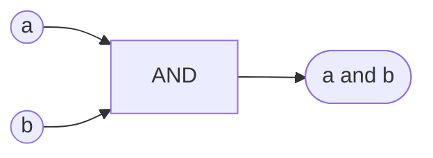
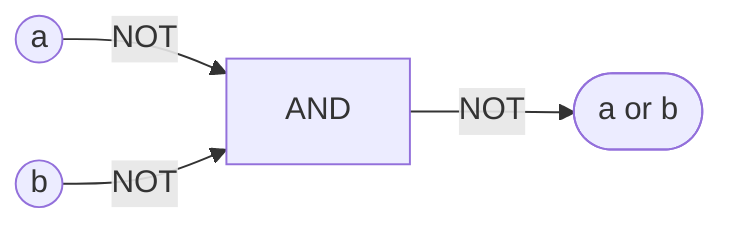
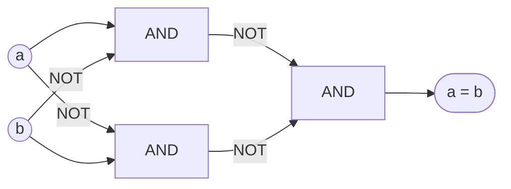
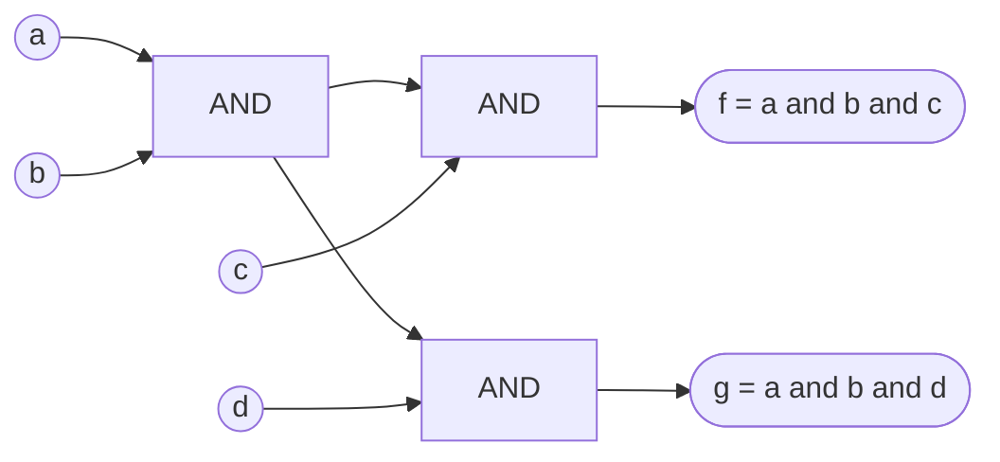
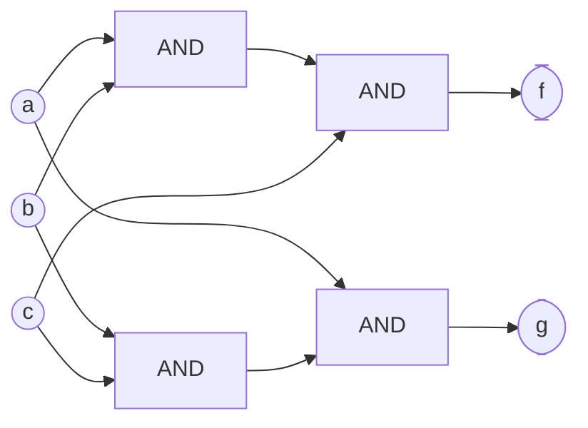
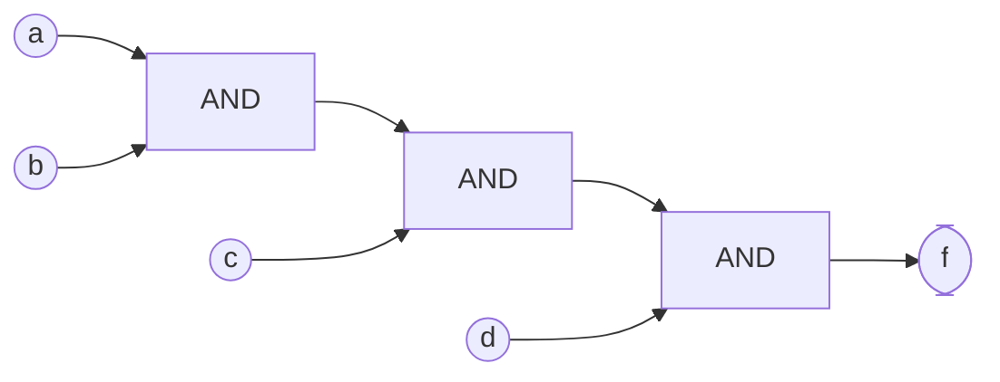
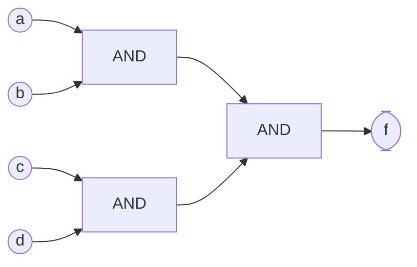
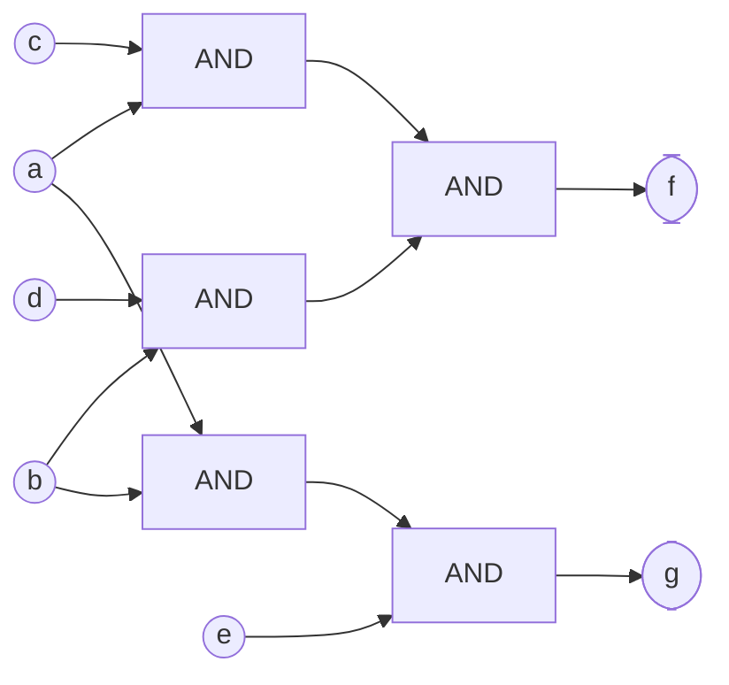

# Representations of Boolean Logic

This is a survey of how existing systems represent and simplify boolean logic,
gathered as input for proposals about boolean logical operations in Define. The
compiler has to reason about compositions of boolean logical operations, and it
has to notice when two compositions are structurally equal. Hardware synthesis
tools, formal verification tools, SMT solvers, and optimizing compilers all
solve versions of that problem, and this note records how.

It was gathered in October 2026. The papers and tools here are mostly old and
stable, but the source code of the tools changes, so details about specific
functions may go out of date.

## Terms Used Here

- **Literal:** a boolean value or its negation, like `a` or `not a`.
- **Circuit:** a set of logic gates connected without cycles. Here, it means the
  same thing as a boolean expression whose common parts are shared.
- **Cone:** everything a particular result depends on, back to the inputs.
- **Size:** how many gates a circuit has.
- **Depth:** the most gates any path from an input to a result goes through.
- **Fanout:** how many other gates use a gate's result. A gate with a fanout of
  more than one is _shared_.
- **Canonical:** a representation is canonical if two expressions that mean the
  same thing always have the same representation. Then checking whether two
  expressions are equal is just checking whether their representations are
  identical.
- **SAT:** the boolean satisfiability problem: is there any assignment of true
  and false to the inputs that makes a formula true? A **SAT solver** is a
  program that answers this.

## Functional Completeness

A set of boolean operations is _functionally complete_ if every boolean function
can be written using only those operations.

### Post's Theorem

Emil Post proved that a set of operations is functionally complete if and only
if it isn't entirely contained in any of five classes
([Wikipedia](https://en.wikipedia.org/wiki/Functional_completeness), citing
Post's 1941 monograph _The Two-Valued Iterative Systems of Mathematical Logic_):

1. **0-preserving:** gives false when every input is false.
2. **1-preserving:** gives true when every input is true.
3. **Monotone:** changing an input from false to true never changes the result
   from true to false.
4. **Self-dual:** negating every input negates the result.
5. **Affine:** each input either has no effect on the result, or flipping that
   input always flips the result, no matter what the other inputs are. `not a`,
   `a xor b`, equality, and the constants are affine. `a and b` isn't: flipping
   `a` changes the result only when `b` is true.

Each class is closed under composition, so if every operation in a set is in the
same class, everything built from the set is too, and the set can't build a
function outside the class. For example:

- `and` and `or` are monotone, so `{and, or}` can't build `not`.
- `not` is self-dual and affine, and so is every function built only from it.
- `{and, not}` and `{or, not}` are complete, because no one class contains both
  operations.

### Universal Gates

A single operation that's functionally complete by itself is called a _universal
gate_ or a _Sheffer function_. NAND (`not (a and b)`) and NOR (`not (a or b)`)
are the only two two-input Sheffer functions
([Wikipedia](https://en.wikipedia.org/wiki/Functional_completeness)). NAND is in
none of the five classes: it gives true when every input is false, false when
every input is true, it isn't monotone, it isn't self-dual (`nand(0, 1)` and
`nand(1, 0)` are both true), and it isn't affine.

XOR (exclusive or) and XNOR (equality) are affine, so neither is complete by
itself, and neither are both together. Equality with constants can build `not`
(`a = false` is `not a`), but nothing built from equality, XOR, `not`, and
constants can build `and`.

### Universal Gates With More Inputs

NAND and NOR are only the two-input universal gates. Counting every truth table
against Post's five classes gives:

| Inputs | Functions | Universal |
| ------ | --------- | --------- |
| 2      | 16        | 2         |
| 3      | 256       | 56        |
| 4      | 65,536    | 16,256    |

These match [OEIS A002542](https://oeis.org/A002542), "Number of two-valued
complete Post functions of n variables," which gives the formula 2^(2ⁿ − 2) −
2^(2ⁿ⁻¹ − 1). A universal gate must give true when every input is false and
false when every input is true, so it's never 0-preserving or 1-preserving. The
formula counts those functions and subtracts the self-dual ones. What's left is
never monotone, since its result goes from true to false when every input goes
from false to true, and an affine function with those two results is always
self-dual, so it was already subtracted.

For example, `not (a and b and c)` (a three-input NAND) is universal, and so is
`not (a and b) and not c`.

### Associative Three-Input Functions

A three-input function `f` is associative if `f(f(a, b, c), d, e)`,
`f(a, f(b, c, d), e)`, and `f(a, b, f(c, d, e))` are always equal, so that a
chain of them can be regrouped. Checking all 256 three-input functions finds 8
that are associative:

- the two constants;
- the first input and the last input, ignoring the others;
- the three-input `and`, `or`, XOR, and XNOR.

None of these is universal: the constants, the projections, `and`, and `or` are
monotone, and XOR and XNOR are affine. So no three-input universal gate is
associative either, just as at two inputs.

### If-Then-Else

`choose(c, x, y)`, which is `x` when `c` is true and `y` otherwise, is the node
of a BDD. Built only from its own inputs, with no constants, it can only build
functions that are both 0-preserving and 1-preserving. If every input is false,
every `choose` picks between two false values, and likewise for true. Checking
every combination over three inputs, the functions `choose` builds are exactly
the 64 of the 256 three-input functions that preserve both. With the constants
`true` and `false`, it builds all 256: `choose(a, false, true)` is `not a`, and
`choose(a, b, false)` is `a and b`.

### NAND and NOR Aren't Associative

`and`, `or`, XOR, and XNOR are associative: grouping doesn't matter. NAND and
NOR aren't:

- `nand(nand(a, b), c)` is `(a and b) or not c`.
- `nand(a, nand(b, c))` is `not a or (b and c)`.

These differ whenever `a` and `c` are equal (for example, `a`, `b`, `c` = false,
false, true gives true for the first and false for the second). NAND is
commutative, so `nand(a, b)` and `nand(b, a)` are the same, but a chain of NANDs
can't be regrouped or flattened into a list without first rewriting it into
`and` and `not`.

### Equality from NAND

The usual NAND circuit for XOR uses four NANDs:

```text
t   = nand(a, b)
u   = nand(a, t)
v   = nand(b, t)
xor = nand(u, v)
```

Equality is `not xor`, which is one more NAND, `nand(xor, xor)`, for five in
total:

| a | b | t | u | v | xor | a = b |
| - | - | - | - | - | --- | ----- |
| 0 | 0 | 1 | 1 | 1 | 0   | 1     |
| 0 | 1 | 1 | 1 | 0 | 1   | 0     |
| 1 | 0 | 1 | 0 | 1 | 1   | 0     |
| 1 | 1 | 0 | 1 | 1 | 0   | 1     |

Showing that this circuit is XOR takes more than De Morgan's laws (which say
`not (a and b)` is `not a or not b`, and `not (a or b)` is `not a and not b`):

1. By De Morgan, `nand(u, v)` is `not u or not v`, which is
   `(a and t) or (b and t)`.
2. `a and t` is `a and not (a and b)`, which by De Morgan is
   `a and (not a or not b)`.
3. Distributing gives `(a and not a) or (a and not b)`. `a and not a` is always
   false, so this is `a and not b`. In the same way, `b and t` is `b and not a`.
4. So the circuit is `(a and not b) or (b and not a)`, which is XOR.

Step 3 needs distribution (`x and (y or z)` is `(x and y) or (x and z)`) and the
fact that `x and not x` is false. A simplifier that only knows De Morgan's laws
can't do it.

By duality, the same circuit with every NAND replaced by NOR computes the dual
of XOR, which is XNOR, so four NORs make an equality.

## And-Inverter Graphs

An And-Inverter Graph (AIG) represents a circuit with only two-input `and` gates
and inverters. It's the standard representation in hardware synthesis and formal
verification tools. Kuehlmann and Krohm used it in
[Equivalence Checking Using Cuts and Heaps](https://doi.org/10.1145/266021.266090)
(DAC 1997), and
[Kuehlmann, Paruthi, Krohm, and Ganai, "Robust Boolean Reasoning for Equivalence Checking and Functional Property Verification"](https://doi.org/10.1109/TCAD.2002.804386)
(IEEE TCAD, 2002) describes it in detail.

An AIG is a directed graph with no cycles:

- Each internal node is a two-input `and`.
- Each edge can be marked as inverted. Inversion isn't a node, so it costs
  nothing: `not` just flips the mark on an edge.
- The leaves are the inputs and the constant false. (Constant true is the
  inverted edge to constant false.)

The 2002 paper's construction operators are `create_input`, `create_and2`, and
`create_inverter`, and "the operation create_inverter simply toggles the
attribute of the handle." Every other operation is built from these.

[ABC](https://github.com/berkeley-abc/abc) is the main open-source system built
on AIGs. It's developed by the Berkeley Logic Synthesis and Verification Group,
and maintained by Alan Mishchenko
([ABC's page](https://people.eecs.berkeley.edu/~alanmi/abc/abc.htm)).
[AIGER](https://fmv.jku.at/aiger/), by Armin Biere and colleagues at Johannes
Kepler University Linz, is the standard file format for AIGs. Its
[format report](https://fmv.jku.at/papers/Biere-FMV-TR-07-1.pdf) encodes each
edge as a number: "A variable is transformed into a literal by multiplying it by
two," and an inverted edge has "its sign bit, the least significant bit, set to
one." So a literal and its negation are always adjacent numbers.

### Examples

`a and b` is one node:



`a or b` is one node, by De Morgan: `not (not a and not b)`:



Equality takes three nodes. `n1` is `a and not b`, `n2` is `not a and b`, and
the result is true when neither is:



XOR is the same three nodes with the last edge inverted, so XOR and equality
cost the same.

Sharing is how an AIG stays small. If two results both need `a and b`, they use
the same node:



### Structural Hashing

_Structural hashing_ keeps a hash table of every `and` node, keyed by its pair
of input edges. Before creating a node, the builder looks up the pair, and if a
node with those inputs already exists, it uses that node instead. In the 2002
paper, `create_and2` first does constant folding (`x and false` is false,
`x and true` is `x`, `x and x` is `x`, `x and not x` is false), then orders the
two inputs "using a unique ranking criteria" so that `a and b` and `b and a`
find the same node, then looks up the pair. The
[DAG-Aware AIG Rewriting](https://doi.org/10.1145/1146909.1147048) paper
(Mishchenko, Chatterjee, and Brayton, DAC 2006) says structural hashing "is
applied during AIG construction to ensure that no two AND gates have identical
pairs of incoming edges."

Each lookup takes constant expected time, so building a structurally hashed AIG
takes time proportional to the number of gates.

### What Structural Hashing Doesn't See

Structural hashing only merges nodes with the same two inputs. It doesn't know
that `and` is associative. `(a and b) and c` and `a and (b and c)` are the same
function, but they're different graphs:



`f`'s top node has inputs `ab` and `c`, and `g`'s has `a` and `bc`, so the hash
table never matches them. The 2002 paper also gives an example of two
differently built but equal nodes that "cannot be shown by simple hashing," and
describes a "functional hashing" extension that compares small groups of nodes
(up to four inputs) by the function they compute.

## Balancing

_Balancing_ rebuilds chains of `and` nodes as trees that are as shallow as
possible. Its purpose in hardware is to reduce depth, which is delay, without
adding gates. ABC's `balance` command "creates an equivalent AIG having the
minimum delay, measured using logic levels of two-input AND-gates," and the
result "is derived by algebraic balancing of the multi-input AND-gates contained
in the original AIG"
([ABC's page](https://people.eecs.berkeley.edu/~alanmi/abc/abc.htm)). The DAC
2006 paper describes it as "algebraic AIG balancing, which minimizes delay
without increasing area," citing tree-height reduction from
[Cortadella, "Timing-Driven Logic Bi-Decomposition"](https://doi.org/10.1109/TCAD.2003.811447)
(IEEE TCAD, 2003).

### How It Works

1. **Gather.** Starting from a node, collect the inputs of the whole chain of
   `and` nodes under it into one multi-input `and` (ABC calls this a
   "supergate"). Collection stops at an inverted edge, because `not (x and y)`
   isn't part of an `and` chain. It also stops at a node with more than one
   user, which becomes an input of the chain instead of being looked through.
2. **Balance the inputs.** Balance each input's own cone the same way.
3. **Rebuild.** Combine the inputs two at a time, always pairing the two
   shallowest, and put each new node back in the list. This is a greedy method
   much like building a Huffman code, and with a priority queue it takes O(n log
   n) time for n inputs.

[ABC's balancer](https://github.com/berkeley-abc/abc/blob/master/src/base/abci/abcBalance.c)
works this way, with a few details:

- Its comment says "if the new node is complemented or a PI, another gate
  begins." (A PI is a primary input.)
- It stops at shared nodes unless an option tells it to duplicate shared logic.
- If the same node appears in both polarities, the whole supergate becomes
  constant false, and repeated inputs are dropped.
- It keeps the inputs in a vector sorted by depth instead of a heap, and takes
  the two shallowest from the end.
- When several inputs have the same depth, it prefers a pair that already exists
  as a node, which it checks with a structural hash lookup, so the rebuilt tree
  shares more with the rest of the graph.
- It caps a supergate at 10,000 inputs.

### Example

`f = ((a and b) and c) and d` has depth 3:



Balancing gathers `AND{a, b, c, d}`, pairs `a` with `b` and `c` with `d`, and
combines the two, for depth 2 with the same three nodes:



Balancing also fixes the associativity example above when the inputs have the
same depths: `(a and b) and c` and `a and (b and c)` both gather to
`AND{a, b, c}`, and if the rebuild pairs ties in a fixed order, both become the
same tree, which structural hashing then merges.

### Shared Nodes

Balancing stops at shared nodes because looking through them can make the result
bigger, even though it makes each chain more balanced. Take:

```text
x = a and b
f = (x and c) and d
g = x and e
```

`x` is used by both `f` and `g`. Keeping it as an input, balancing gathers `f`
as `AND{x, c, d}`. `x` has depth 1 and `c` and `d` have depth 0, so it pairs `c`
with `d` first:

```text
x = a and b
y = c and d
f = x and y
g = x and e
```

That's four nodes, and `f` has depth 2. This is optimal in both size and depth:
`f` depends on four inputs, so it needs at least three nodes and depth 2, and
`g` depends on `e`, which `f` doesn't, so `g` needs at least one more node.

Looking through `x` gathers `f` as `AND{a, b, c, d}`. If the rebuild pairs them
differently, as `(a and c) and (b and d)`, `f` takes three nodes that don't
include `a and b`, but `g` still needs `x`, for five nodes in total:



Regrouping `g` as well doesn't help: `g` would be something like
`(a and e) and b`, which shares no pair of inputs with `f`'s nodes, and still
takes two nodes. Two results only share a node when they both use the same pair
of inputs, and the regrouped `f` no longer has the pair `a and b`.

At a larger scale, looking through shared nodes can make the result much bigger.
Suppose `x` is the `and` of 100 inputs, and 100 results each `and` `x` with one
more input of their own. With `x` shared, that's 99 nodes for `x` and one node
for each result, 199 in total. If each result is flattened through `x` into a
101-input `and`, each one needs 100 nodes, so about 10,000 in total, unless the
balanced trees happen to pair their inputs in the same way. (ABC's preference
for pairs that already exist would recover much of that sharing in this example,
but nothing guarantees it in general.)

### Cost

Gathering, balancing, and rebuilding a chain takes time roughly proportional to
its number of inputs, times log n for the priority queue. When shared nodes are
inputs, each node is gathered into exactly one chain, so balancing the whole
graph takes about O(n log n) time.

When balancing looks through shared nodes, a node can be gathered into many
chains, but each chain still has at most n inputs, and there are at most n
chains, so the work is at most quadratic. It can't be worse than that, because
balancing never looks through an inverted edge. A gathered chain is only a set
of inputs, never an `and` of `or`s that would have to be multiplied out.

## SAT Sweeping

_SAT sweeping_ finds nodes that compute the same function, however they're
built, and merges them. In ABC, it's called _fraiging_, after FRAIG
(Functionally Reduced And-Inverter Graph), an AIG in which no two nodes compute
the same function or opposite functions. ABC's `fraig` command does it.

[Mishchenko, Chatterjee, Brayton, and Eén, "Improvements to Combinational Equivalence Checking"](https://doi.org/10.1109/ICCAD.2006.320087)
(ICCAD 2006,
[PDF](https://people.eecs.berkeley.edu/~alanmi/publications/2006/iccad06_cec.pdf))
defines the terms: "Transforming an AIG into a functionally reduced AIG is
called fraiging," and the same process done with SAT "is known as ... SAT
sweeping." FRAIGs were first described in a 2005 Berkeley technical report,
"FRAIGs: A Unifying Representation for Logic Synthesis and Verification," by
Mishchenko, Chatterjee, Jiang, and Brayton
([ABC's page](https://people.eecs.berkeley.edu/~alanmi/abc/abc.htm),
[FRAIG page](https://people.eecs.berkeley.edu/~alanmi/research/fraigs/index.htm)).
The FRAIG page lists a draft of it as "to be submitted to DAC '05," and no
published conference version turned up.

### How It Works

1. **Simulate.** Assign random values to the inputs and compute every node, 64
   input patterns at a time with 64-bit words. Group nodes that gave the same
   results (or exactly opposite results) on every pattern. Nodes in different
   groups are certainly different. Nodes in the same group might be equal. This
   step takes time proportional to the size of the graph times the number of
   patterns.
2. **Prove.** For each pair of candidate nodes, in order from the inputs toward
   the results, ask a SAT solver whether any input assignment makes them differ.
   If not, they're equal, and one replaces the other. If so, the solver's
   assignment is a new simulation pattern that separates them, and usually
   separates other candidates too.

The ICCAD 2006 paper says "random simulation is done until 'saturation'," and
then "these candidate equivalent nodes are checked by SAT, giving preference to
node pairs appearing earlier in a topological order."

### Cost

SAT is NP-complete, and checking whether two circuits compute the same function
(_combinational equivalence checking_) is coNP-complete: no known algorithm
solves every case in less than exponential time
([Berkeley course overview](https://people.eecs.berkeley.edu/~alanmi/courses/2007_290N/overview.htm)).
So each SAT call can take exponential time in the worst case.

Tools handle this with limits on each call. The ICCAD 2006 paper says "fraiging
may be forced to quit proving equivalence of a pair of intermediate nodes when a
user-specified limit on the number of conflicts is reached. In this case, the
functional reduction of the AIG is not complete." (A _conflict_ is a dead end in
the SAT solver's search, so counting them measures how hard the solver has
worked.) As a result, which nodes get merged depends on the limits and on the
order of the SAT calls. Two equal nodes can stay separate if proving them equal
was too hard.

### What It Finds That Balancing Doesn't

Balancing only knows that `and` is associative and commutative. SAT sweeping
finds nodes that are equal for any reason, including:

- **Absorption:** `a and (a or b)` is `a`.
- **Distribution:** `a and (b or c)` is `(a and b) or (a and c)`.
- **Consensus:** `(a and b) or (not a and c) or (b and c)` is
  `(a and b) or (not a and c)`, because the last term is true only when one of
  the first two is.
- **Different circuits for the same function**, like the NAND equality circuit
  above and the three-node AIG equality.

### Small Cones

When a pair of nodes depends on six or fewer inputs, SAT isn't needed. Six
inputs have 2⁶ = 64 combinations, so the whole function fits in one 64-bit word
(a _truth table_), and simulating all 64 patterns proves or disproves equality
exactly. More inputs need more words: 2ⁿ⁻⁶ of them for n inputs.

ABC's rewriting also works on small groups of nodes with precomputed tables. The
DAC 2006 paper uses groups with four inputs, represents their functions "using
truth tables stored as 16-bit bit-strings," and notes that "there are 222 NPN
equivalence classes of 4-variable functions" (functions that are the same after
negating or reordering inputs, or negating the result). Only about 40 of those
classes improved results in its experiments, and those are the ones it
precomputes good circuits for: "All non-redundant AIG subgraphs of the
representative functions of the useful equivalence classes are pre-computed in
advance as a shared DAG containing approximately one thousand nodes and hashed
by the truth table."

SAT matters when the cone has many inputs. For example, two different designs of
a 32-bit comparison depend on 64 inputs, which is 2⁶⁴ combinations, too many to
simulate.

### Checking Two Whole Circuits

To check whether two whole circuits are equivalent, tools combine them into one
circuit called a _miter_ and ask a SAT solver about it. The ICCAD 2006 paper
describes it: the two circuits are "transformed into a single circuit called a
miter [4] derived by combining the pairs of inputs with the same names and
feeding the pairs of outputs with the same names into EXOR gates, which are ORed
to produce the single output of the miter." "If the solver returns
'unsatisfiable', the miter is proved constant 0 and the original circuits are
equivalent. If the solver returns 'satisfiable', a counter-example is returned."
The term comes from
[Brand, "Verification of Large Synthesized Designs"](https://doi.org/10.1109/ICCAD.1993.580110)
(ICCAD 1993), which this research didn't read directly. The ICCAD 2006 paper
cites it for "miter".

The miter goes to the solver as CNF, with three clauses for each two-input `and`
gate ("a two-input AND, c = ab, leads to ... three CNF clauses"), which is the
Tseitin transformation described in
[Other Representations](#other-representations). That transformation only keeps
satisfiability, not the formula's meaning, but that's all this question needs:
"is there an input where the two circuits differ?" is itself a satisfiability
question. Every assignment of the original inputs also determines exactly one
value for each new variable, so no combination of inputs is lost or added.

So this is an exact test. It never misses an equivalence and never reports a
false one, when the solver is allowed to run to completion. Its cost is the cost
of SAT, coNP-complete in the worst case, as described above.
[Goldberg, Prasad, and Brayton, "Using SAT for Combinational Equivalence Checking"](https://doi.org/10.1109/DATE.2001.915010)
(DATE 2001,
[PDF](https://past.date-conference.com/proceedings-archive/2001/DATE01/pdffiles/03a_1.pdf))
argues "that SAT is a more robust and flexible engine of Boolean reasoning for
the CEC application than BDDs." In practice, tools combine it with SAT sweeping,
which merges equal nodes inside the two circuits so that the final question is
small.

## Boolean Matching

_Technology mapping_ is the step of chip design that covers a circuit with gates
from a library. To do that, a tool has to find every part of the circuit that
computes the same function as some library gate, however that part is built. The
standard method uses cuts and truth tables.

### Cuts

[Mishchenko, Cho, Chatterjee, and Brayton, "Combinational and Sequential Mapping with Priority Cuts"](https://doi.org/10.1109/ICCAD.2007.4397290)
(ICCAD 2007,
[PDF](https://people.eecs.berkeley.edu/~alanmi/publications/2007/iccad07_map.pdf))
defines them: "A cut C of node n, called root, is a set of nodes of the network,
called leaves, such that each path from a PI to n passes through at least one
leaf." (A PI is a primary input.) "A cut is K-feasible if the number of nodes in
it does not exceed K." So a node's value is a function of the values of any of
its cuts. [Cong and Ding, "FlowMap"](https://doi.org/10.1109/43.273754) (IEEE
TCAD 13(1), 1994) defined and used K-feasible cuts for mapping onto lookup
tables, as a partition of the circuit's nodes.

Cuts are enumerated from the inputs toward the results, by merging the cuts of
each node's children.
[Pan and Lin, "A New Retiming-Based Technology Mapping Algorithm for LUT-based FPGAs"](https://doi.org/10.1145/275107.275118)
(FPGA 1998) proves that a node's cuts are the merges of its children's cuts plus
the node itself, and that "for a circuit without feedback loops, we can compute
the k-cuts of all nodes by examining the nodes in topological order starting
from the PIs." The ICCAD 2007 paper writes it as Φ(n) = {{n}} ∪ Φ(n₁) ◊ Φ(n₂),
where A ◊ B is every union of one cut from A and one from B with at most K
nodes, and credits the method to Pan and Lin and to
[Cong, Wu, and Ding, "Cut Ranking and Pruning"](https://doi.org/10.1145/296399.296425)
(FPGA 1999).

### How Many Cuts There Are

The number of cuts grows quickly with K. The ICCAD 2007 paper says "for K equal
to 4 or 5, exhaustive cut enumeration [14][5] can be applied, resulting in an
average of 10-40 cuts stored at each node. When the LUT size is 6, exhaustive
cut enumeration may lead to 100+ cuts per node," and "the number of 8-input cuts
is extremely large and can be computed only for the smallest benchmarks." Its
answer is _priority cuts_: "computing only a small fixed number (typically,
5-10) of 'good' K-feasible cuts at each node." Which cuts a tool keeps then
depends on how it ranks them.

A small experiment for this note enumerated every cut, with no pruning, on
random AIGs shaped like straight-line code: each `and` node's two inputs were
chosen at random from the 12 most recent nodes and inputs. It built three graphs
for each size and recorded the most cuts any single node had:

| K | Inputs | `and` nodes | Most cuts at one node |
| - | ------ | ----------- | --------------------- |
| 4 | 6      | 64          | 315                   |
| 4 | 6      | 256         | 183                   |
| 4 | 16     | 64          | 195                   |
| 4 | 16     | 256         | 461                   |
| 6 | 6      | 32          | 1,465                 |
| 6 | 6      | 64          | 37,195                |
| 6 | 16     | 64          | 3,931                 |

With K = 4, the most at any node stayed in the hundreds as the graphs grew, and
the total grew roughly in proportion to the number of nodes (16,824 cuts in all
for 256 nodes). With K = 6, one node of a 64-node graph had 37,195 cuts. The
graphs are random, so real code could do better or worse.

### Matching Truth Tables

For each cut, the tool computes the node's truth table over the cut's leaves,
which takes a few bitwise operations from the children's tables. With 4 leaves,
it's 16 bits. Then it looks the table up in a hash table of the library's gates.

A table depends on the order of the cut's leaves, so the lookup has to ignore
that order.
[Chatterjee, Mishchenko, Brayton, Wang, and Kam, "Reducing Structural Bias in Technology Mapping"](https://doi.org/10.1109/ICCAD.2005.1560122)
(ICCAD 2005,
[PDF](https://people.eecs.berkeley.edu/~alanmi/publications/2005/iccad05_map.pdf))
describes two ways:

- **Canonical forms:** "The traditional solution is to use NPN-equivalence
  classes… First the NPN-canonical representatives of the library gates are
  computed. The gates are stored in a hash table indexed by the representatives.
  During matching the NPN-canonical representative is computed for every cut
  function." A representative can be, for example, "the function with the
  lexicographically smallest truth table."
- **Every permutation in the table:** "precompute all functions obtained by
  permuting the inputs to library gates and to add those to the hash table. Thus
  during the actual matching, there is no need to compute a canonical
  representative." A four-input gate has at most 4! = 24 permutations.

Counting only reorderings of the inputs, without negations, there are 3,984
classes of four-input functions ([OEIS A003180](https://oeis.org/A003180),
"Number of equivalence classes of Boolean functions of n variables under action
of symmetric group"), compared with the 222 NPN classes.

The same truth tables show when a node is constant or is the same as one of its
leaves: its table is all zeros, all ones, or one leaf's table.

### Turning a Truth Table Back Into Logic

Optimizers also go the other way: given a cut's truth table, they build new,
smaller logic for it. The usual first step is the Minato–Morreale ISOP
algorithm, which turns a truth table or a BDD into an `or` of `and`s of inputs
and negated inputs, called _cubes_.
[Minato, "Fast Generation of Prime-Irredundant Covers from Binary Decision Diagrams"](https://eprints.lib.hokudai.ac.jp/dspace/handle/2115/47468)
(IEICE Transactions on Fundamentals E76-A(6), 1993) says the method "is based on
the idea of a recursive operator, proposed by Morreale" (IEEE Transactions on
Computers, 1970, not read for this note).

The result is a _prime-irredundant cover_, which the paper defines by two
properties: in each cube, "no literal can be eliminated without changing the
function," and "no cube can be eliminated without changing the function." The
algorithm splits the function on one input `v`. It recursively finds the cubes
that need `not v`, the cubes that need `v`, and then cubes for what's left,
which don't mention `v`, and joins them as
`(not v and isop0) or (v and isop1) or isop_rest`. The paper says it "can be
applied for functions with don't cares."

The result isn't the smallest form: "Prime-irredundant covers are very compact
in general, but they are not necessarily the minimum form." It is unique once
the order of the inputs is fixed: "If the expanding order of the input variables
is fixed, ISOP generates a unique form for each function."

ABC computes ISOPs directly on truth tables in
[`kitIsop.c`](https://github.com/berkeley-abc/abc/blob/master/src/bool/kit/kitIsop.c)
("ISOP computation based on Morreale's algorithm"). Its refactoring command
"computes a reconvergence-driven cut, derives BDD of the cut function,
constructs ISOP, factors the ISOP, and replaces the current implementation" when
that saves nodes without adding levels
([`abcRefactor.c`](https://github.com/berkeley-abc/abc/blob/master/src/base/abci/abcRefactor.c)).

## A Normalized Form for Structural Equality

Several tools go past two-input nodes and keep each `and` as a list of all its
inputs, with rules that make equal expressions identical in common cases. One
form that combines their rules is:

- Each node is an `and` of a **set of literals**, where a literal is a reference
  to a node plus a polarity (inverted or not), as in an AIG.
- Nodes are **hash-consed**: a hash table maps each set of literals to its node,
  so two `and`s of the same set are the same node.

### Construction Rules

When building `AND` of some literals:

1. **Flatten.** If an input is a non-inverted `and` node, use its inputs
   instead. Inverted inputs stay as they are, because `not (x and y)` isn't an
   `and`.
2. **Sort and remove duplicates.** Sort the literals by node and polarity, and
   remove repeats.
3. **Contradiction.** If a literal and its negation are both there, the result
   is false. If literals are numbered like AIGER's, they're adjacent after
   sorting, so this check is part of the same pass.
4. **Constants.** Drop `true`. If `false` is there, the result is false. An
   `and` of nothing is true.
5. **One input.** `AND{x}` is just `x`.
6. **Look up** the sorted set in the hash table and reuse the node if it exists.

`not` flips a literal's polarity, so `not (not x)` is `x` without a rule.

Then two expressions are structurally equal exactly when they're the same
literal, which is a constant-time comparison.

### What It Catches

| Fact                          | Example                                   |
| ----------------------------- | ----------------------------------------- |
| Associativity                 | `(a and b) and c` = `a and (b and c)`     |
| Commutativity                 | `a and b` = `b and a`                     |
| Idempotence                   | `a and a` = `a`                           |
| Contradiction                 | `a and not a` = false                     |
| Constants                     | `a and true` = `a`, `a and false` = false |
| Double negation               | `not (not a)` = `a`                       |
| De Morgan (by representation) | `a or b` = `not (not a and not b)`        |

The last row holds because `or` isn't a separate node at all: `a or b` is built
as `not AND{not a, not b}`.

`a or not a` looks like something it would miss, but it's caught too: it's built
as `not AND{not a, a}`, the contradiction rule turns the `AND` into false, and
`not false` is true.

### What It Misses

The form only finds equalities that come from rearranging the same structure.
Anything that needs reasoning about `or` inside `and` produces two different
sets of literals:

| Fact                      | Example                                                                   | Why the form misses it                                                             |
| ------------------------- | ------------------------------------------------------------------------- | ---------------------------------------------------------------------------------- |
| Absorption                | `a and (a or b)` = `a`                                                    | It's built as `AND{a, not AND{not a, not b}}`, which is a different node from `a`. |
| Distribution              | `a and (b or c)` = `(a and b) or (a and c)`                               | The two sides are nested differently, so they're different nodes.                  |
| Consensus                 | `(a and b) or (not a and c) or (b and c)` = `(a and b) or (not a and c)`  | `b and c` is redundant only by considering both cases of `a`.                      |
| Equality written two ways | `(a and b) or (not a and not b)` = `not ((a and not b) or (not a and b))` | Both are equality of `a` and `b`, built from different nodes.                      |
| Facts about the inputs    | `x < 3 and x < 5` = `x < 3`                                               | The two comparisons are unrelated literals to the form.                            |

These can't all be fixed by adding more construction rules. Deciding whether two
boolean formulas are equal is coNP-complete, so unless P = NP, no form that
takes polynomial time to build catches every equality. Finding the rest takes
something whose worst case is exponential, like [SAT sweeping](#sat-sweeping),
or a form that can be exponentially large, like the canonical forms in
[The Knowledge Compilation Map](#the-knowledge-compilation-map). The last row
also needs reasoning about numbers, which is what SMT solvers do.

### Flattening Through Shared Nodes

The form has the same choice balancing has:

- **Always flatten**, even through nodes with more than one user. Then the form
  is canonical for everything in the table above: any two expressions that
  differ only by those facts become the same node. But as in the balancing
  example, a big shared `and` gets copied into every `and` that uses it, so the
  total size can be quadratic in the worst case.
- **Flatten only nodes with one user.** Then the size stays linear, but the form
  is canonical only when the expressions share the same nodes. For example, if
  `x = a and b` is used elsewhere and `f = x and c`, while `y = b and c` is used
  elsewhere and `g = a and y`, then `f` is `AND{x, c}` and `g` is `AND{a, y}`.
  They're equal, but not the same node.

### Hashing Sets

The hash table needs a hash of a set of literals that doesn't depend on order.
Two common ways:

- **Hash the sorted list.** The literals are sorted anyway, so hashing them in
  order gives the same hash for the same set.
- **Combine element hashes with a commutative operation**, like adding them.
  This doesn't need sorting, so it can be updated as literals are added.

The combining approach has a trap. `and` ignores duplicates, so `AND{x, x}` and
`AND{x}` must be the same node. If duplicates aren't removed before hashing, a
sum gives them different hashes (`2h(x)` and `h(x)`). Combining with XOR instead
of addition has the opposite problem: duplicate pairs cancel, so `AND{x, x, y}`
and `AND{y}` collide, which is a collision between nodes that really are
different. Either way, duplicates have to be removed first.

### Building It During Construction

The form can be built as each `and` is created, in one pass, instead of being
computed afterward. This is the same idea as hash-consing and value numbering
(see the next section): normalize each new node's inputs, then look it up.

Flattening only single-use nodes needs to know, when building a node, how many
users each input will have, which a single forward pass doesn't know yet. A pass
that counts uses first solves this. Define's value operations are Single
Assignment: each local view is set exactly once, and value operations are small
and straight-line. So a value operation's use counts can be found in one pass
over its statements, before the normalized form is built.

### In Existing Tools

- **Z3** (an SMT solver from Microsoft Research). Its
  [boolean rewriter](https://github.com/Z3Prover/z3/blob/master/src/ast/rewriter/bool_rewriter.cpp)
  flattens nested `and`s and `or`s (the `flat_and_or` option, on by default),
  drops `true` from an `and`, turns an `and` containing `false` into `false`,
  removes repeated arguments, and turns an `and` containing both `x` and `not x`
  into `false`. It sorts the arguments of `or` (the `sort_disjunctions` option,
  on by default) but not of `and`. An `elim_and` option, off by default,
  rewrites every `and` as `not (or (not ...))`
  ([defaults](https://github.com/Z3Prover/z3/blob/master/src/params/bool_rewriter_params.hpp)).
  Z3's terms are hash-consed, so identical terms are the same object. (From
  memory.)
- **cvc5** (an SMT solver from Stanford and the University of Iowa). Its
  [boolean rewriter](https://github.com/cvc5/cvc5/blob/main/src/theory/booleans/theory_bool_rewriter.cpp)
  flattens nested `and`s and `or`s, removes repeated children while flattening,
  and handles constants. It doesn't check for `x and not x` in its main rewrite,
  and it doesn't sort the children of `and` or `or`.
- **Yices** (an SMT solver from SRI). It's the closest to the form above. Its
  [term table](https://github.com/SRI-CSL/yices2/blob/master/src/terms/terms.h)
  has no `not` node: each term occurrence is an index with a polarity bit, and
  "Negation: just flip the polarity bit." Its terms are hash-consed. It has no
  `and` node either:
  [`mk_and`](https://github.com/SRI-CSL/yices2/blob/master/src/terms/term_manager.c)
  negates its arguments, calls `mk_or`, and negates the result. `mk_or` sorts
  its arguments, removes duplicates, and returns `true` if it finds `x` and
  `not x`, noting that "if x and (not x) are both in a, then they occur at
  successive positions in a after sorting." It doesn't flatten nested `or`s.
- **LLVM's Reassociate pass**
  ([documentation](https://llvm.org/docs/Passes.html#reassociate-reassociate-expressions)).
  LLVM is a widely used compiler framework. This pass turns a tree of the same
  associative and commutative operation into a list of operands, then sorts the
  operands by a _rank_: "constants are assigned rank = 0, function arguments are
  rank = 1," and other values get ranks by their order in the function. For
  `and`, `or`, and XOR, its
  [source](https://github.com/llvm/llvm-project/blob/main/llvm/lib/Transforms/Scalar/Reassociate.cpp)
  drops duplicate operands of `and` and `or`, cancels equal pairs in XOR, and
  turns `x and not x` into 0 and `x or not x` into all ones. When it turns a
  tree into a list, it treats a value with more than one use as a leaf, unless
  all of its uses turn out to be in the same tree.
- **Term rewriting systems.** The textbook
  [Baader and Nipkow, _Term Rewriting and All That_](https://doi.org/10.1017/CBO9781139172752)
  (Cambridge University Press, 1998) covers the theory of rewriting terms into
  normal forms, including when a set of rules always reaches one. Associativity
  and commutativity (AC) can't be used as ordinary rewrite rules, because
  commutativity applies forever. [Maude](https://maude.cs.illinois.edu/), a
  rewriting language, instead lets an operator be declared `assoc` and `comm`,
  and then treats terms that differ only by those laws as identical
  ([manual](https://maude.cs.illinois.edu/manual/maude-manualch4.html)). AC
  terms are typically represented by flattening nested uses of the operator into
  one argument list and sorting it
  ([Alpuente, Ballis, Espert, and Romero, 2011](https://arxiv.org/abs/1105.2665)).
  [Eker, "Associative-Commutative Rewriting on Large Terms"](https://doi.org/10.1007/3-540-44881-0_3)
  (RTA 2003) describes a representation Maude 2 uses for large AC argument
  lists.

## Value Numbering and Hash-Consing

The form above combines two old ideas from compilers and functional languages.

- **Common subexpressions.**
  [Ershov, "On Programming of Arithmetic Operations"](https://doi.org/10.1145/368892.368907)
  (Communications of the ACM, 1958, translated from a Russian paper in
  _Doklady_) describes a compiler that computes a function of each instruction's
  operation and operands, and compares the result against instructions it has
  already built, so that a formula's duplicate parts are computed once
  ([scanned translation](https://www.cs.utexas.edu/~hunt/research/hash-cons/hash-cons-papers/ershov-8-1958.pdf)).
  The editor's note says that "a check is made for duplicate strings of any
  length," in time "linearly proportional to the number of instructions."
- **Hash-consing.** Eiichi Goto's "Monocopy and Associative Algorithms in an
  Extended Lisp" (University of Tokyo, 1974,
  [scanned copy](https://www.cs.utexas.edu/~hunt/research/hash-cons/hash-cons-papers/monocopy-goto.pdf))
  added "monocopy" values to Lisp. This is usually credited as the origin of
  hash-consing: when a value is built, a hash table returns the existing copy if
  there is one, so equal values are always the same object and can be compared
  in constant time. (The scan is hard to read, so this description is from later
  accounts.)
  [Filliâtre and Conchon, "Type-Safe Modular Hash-Consing"](https://doi.org/10.1145/1159876.1159880)
  (ACM Workshop on ML, 2006) is a modern library version for OCaml. It is
  "parameterized by an equality," so terms can be shared under any equivalence
  the user chooses, not only structural equality
  ([abstract](https://gallium.inria.fr/ml2006/accepted/5.html)).
- **Value numbering.** Compilers give each computed value a number so that
  values computed the same way get the same number.
  [Alpern, Wegman, and Zadeck, "Detecting Equality of Variables in Programs"](https://doi.org/10.1145/73560.73561)
  (POPL 1988) does this for programs in SSA form (Static Single Assignment,
  where each variable is assigned once).
  [Click, "Global Code Motion / Global Value Numbering"](https://doi.org/10.1145/207110.207154)
  (PLDI 1995) uses "a simple hash-based technique," which is the same idea as
  structural hashing: look up each new instruction's operation and operands in a
  hash table. A common refinement sorts the operands of commutative operations
  before the lookup, which is what `create_and2` does.

## Program Verifiers

Program verifiers like Dafny turn a program into a logical formula, a
_verification condition_ (VC), that's valid exactly when the program is correct,
and give it to an SMT solver.
[Leino, "Dafny: An Automatic Program Verifier for Functional Correctness"](https://doi.org/10.1007/978-3-642-17511-4_20)
(LPAR-16, 2010) says "Dafny's program verifier works by translating a given
Dafny program into the intermediate verification language Boogie 2 ... The
Boogie tool is then used to generate first-order verification conditions that
are passed to a theorem prover, in particular to the SMT solver Z3."
[Boogie's README](https://github.com/boogie-org/boogie) says "The default SMT
solver is Z3."

### Keeping Verification Conditions Small

The textbook way to build a VC, _weakest preconditions_, works backward from
what must be true at the end of the program. It copies that formula at every
branch, so the VC can grow exponentially with the program.
[Leino, "Efficient Weakest Preconditions"](https://doi.org/10.1016/j.ipl.2004.10.015)
(Information Processing Letters 93(6), 2005,
[technical report](https://www.microsoft.com/en-us/research/wp-content/uploads/2016/02/tr-2004-34.pdf))
says "we duplicate Q. This results in a verification condition whose size is
exponential in the size of the program."

[Flanagan and Saxe, "Avoiding Exponential Explosion: Generating Compact Verification Conditions"](https://doi.org/10.1145/360204.360220)
(POPL 2001) point to two causes: branches copy the formula, and assignments
substitute into the copies, so the copies aren't even identical and can't simply
be shared. Their fix is _passive form_: "replace each assignment statement x :=
e by an assumption assume x' = e where x' is a fresh variable." Each name then
has one value, as in SSA (Static Single Assignment) form. Their method
"generates compact VCs whose size is worst-case quadratic in the size of the
source fragment, and is close to linear in practice." Leino's 2005 paper
restates this in terms of weakest preconditions, also with a quadratic bound.

[Barnett and Leino, "Weakest-Precondition of Unstructured Programs"](https://doi.org/10.1145/1108792.1108813)
(PASTE 2005,
[PDF](https://www.microsoft.com/en-us/research/wp-content/uploads/2005/01/krml157.pdf))
goes further by naming each block of the program: "For every block ... we
introduce an auxiliary variable ... Intuitively, [it] is true if the program is
in a state from which all executions beginning from block [A] are correct."
Their VC "is linear in the size of the passive program." The paper is about
Spec#, a verifier for an extension of C# that also used Boogie.

Naming each block's formula with a variable is the same idea as the Tseitin
transformation's new variable for each gate, applied to blocks of a program
instead of to gates.

### Inside Z3

[de Moura and Bjørner, "Z3: An Efficient SMT Solver"](https://doi.org/10.1007/978-3-540-78800-3_24)
(TACAS 2008) says the formula "is converted into a different data-structure
comprising of a set of clauses and congruence-closure nodes," without saying
how. The source code shows a Tseitin-style encoding: in
[`smt_internalizer.cpp`](https://github.com/Z3Prover/z3/blob/master/src/smt/smt_internalizer.cpp),
each `and`, `or`, implication, and if-then-else node gets its own boolean
variable (`mk_bool_var`), and `mk_and_cnstr` adds clauses relating that variable
to its arguments. Z3 also has a separate `tseitin-cnf` tactic
([`tseitin_cnf_tactic.h`](https://github.com/Z3Prover/z3/blob/master/src/tactic/core/tseitin_cnf_tactic.h)),
which "convert[s] goal into CNF using tseitin-like encoding ... Auxiliary
variables are used to avoid blowup."

The paper also describes _relevancy propagation_: "DPLL(T) based solvers assign
a Boolean value to potentially all atoms appearing in a goal. In practice,
several of these atoms are don't cares. Z3 ignores these atoms for expensive
theories, such as bit-vectors, and inference rules, such as quantifier
instantiation." It's controlled by the `smt.relevancy` parameter, whose default
of 2 means "relevancy is tracked, and an atom is only asserted if it is
relevant"
([`smt_params_helper.hpp`](https://github.com/Z3Prover/z3/blob/master/src/params/smt_params_helper.hpp)).

### Instability

Whether a solver proves a VC, and how long it takes, can depend on details that
don't change what the VC means.
[Zhou, Bosamiya, Takashima, Li, Heule, and Parno, "Mariposa: Measuring SMT Instability in Automated Program Verification"](https://doi.org/10.34727/2023/isbn.978-3-85448-060-0_26)
(FMCAD 2023, [PDF](https://www.andrew.cmu.edu/user/bparno/papers/mariposa.pdf))
measures this by shuffling assertions, renaming symbols, and changing the
solver's random seed. They observed that "simply renaming a source-level
variable may cause a verified procedure to take orders of magnitude longer to
verify, or even to fail to verify at all." Across "17,043 SMT queries from six
existing program verification projects" in Dafny, F\*, and Serval, "the most
recent SMT solver version is unstable on 2.6% of the queries. For individual
projects, the unstable ratio can grow to 5.0%." A query counts as unstable when
between 5% and 95% of its variations succeed. They also found that "SMT solver
upgrades often make projects less stable."

## Other Representations

- **XOR-And-Inverter Graphs (XAGs).** Like AIGs, but with two-input XOR nodes as
  well as `and` nodes. In an AIG, XOR and equality each take three nodes. In an
  XAG they take one, so XAGs are smaller for logic with a lot of XOR, like
  arithmetic, parity, and cryptography.
  [Testa, Soeken, Amarù, and De Micheli, "Reducing the Multiplicative Complexity in Logic Networks for Cryptography and Security Applications"](https://doi.org/10.1145/3316781.3317893)
  (DAC 2019) optimizes XAGs to minimize the number of `and` nodes, which is what
  costs the most in some cryptographic protocols.
- **Majority-Inverter Graphs (MIGs).**
  [Amarù, Gaillardon, and De Micheli, "Majority-Inverter Graph: A Novel Data-Structure and Algorithms for Efficient Logic Optimization"](https://doi.org/10.1145/2593069.2593158)
  (DAC 2014,
  [PDF](https://si2.epfl.ch/demichel/publications/archive/2014/PID3143501.pdf))
  defines "a directed acyclic graph consisting of three-input majority nodes and
  regular/complemented edges." The majority of three values is true when at
  least two of them are. "M(a, b, c) behaves as the conjunction operator AND(a,
  b) when c = 0 and as the disjunction operator OR(a, b) when c = 1," so every
  AIG is an MIG. The paper gives five rewrite rules, called Ω (commutativity,
  majority, associativity, distributivity, and inverter propagation), and proves
  that "it is possible to transform any MIG α into any other logically
  equivalent MIG β, by a sequence of transformations in Ω." It reports that "MIG
  optimization reduces the number of logic levels by 18%, on average, with
  respect to AIG optimization performed by ABC." It says MIGs help "especially
  with respect to datapath circuits, as majority functions are the ground for
  arithmetic operations": the carry of a full adder is the majority of its three
  inputs, which is one MIG node and four AIG nodes. It also gives a second
  reason to study them: "majority/minority gates are natively implemented in
  different nanotechnologies."
- **Read-once formulas.** A formula is read-once if every input appears in it
  only once. Golumbic and Gurvich, "Read-once functions," chapter 10 of Crama
  and Hammer, _Boolean Functions: Theory, Algorithms, and Applications_
  ([Cambridge University Press, 2011](https://doi.org/10.1017/CBO9780511852008),
  [author's preprint](https://www.ipu.ru/sites/default/files/news/readonce-chapter-final%20%281%29.pdf)),
  observes that "read-once functions must be monotone (or unate), since every
  variable appears either in its positive or negative form in the read-once
  expression." So a function where turning one input on sometimes turns the
  result on and sometimes turns it off has no read-once formula without copying
  inputs. The four-input hidden weighted bit function, which returns the input
  at the position given by how many inputs are true, is one: with `b` true and
  `c` false, turning `a` on changes the result from false to true when `d` is
  false, and from true to false when `d` is true.
- **Reduced ordered binary decision diagrams (BDDs).** A BDD represents a
  function as a graph of if-then-else choices on one input at a time, with every
  path testing the inputs in the same fixed order, and with duplicate and
  redundant nodes removed.
  [Bryant, "Graph-Based Algorithms for Boolean Function Manipulation"](https://doi.org/10.1109/TC.1986.1676819)
  (IEEE Transactions on Computers, 1986) showed that for a fixed input order,
  this form is canonical, so equality is a pointer comparison. The cost is size:
  a BDD's size depends heavily on the input order, and some functions are
  exponentially large under every order. The middle bit of a product of two
  numbers is the standard example
  ([Bryant's tutorial](https://courses.e-ce.uth.gr/CE437/handouts/BDDs-Bryant-Handouts.pdf)).
- **Algebraic normal form (ANF).** Every boolean function can be written in
  exactly one way as an XOR of `and`s of inputs, possibly with the constant
  true, which makes it canonical
  ([Wikipedia](https://en.wikipedia.org/wiki/Algebraic_normal_form)). It's also
  called the Zhegalkin polynomial. It can be exponentially large too: `a or b`
  is `a xor b xor (a and b)`, and the `or` of n inputs has all 2ⁿ − 1 possible
  `and` terms.
- **Conjunctive normal form (CNF).** An `and` of clauses, where each clause is
  an `or` of literals. It's the input format of SAT solvers. Turning an
  arbitrary formula into an equivalent CNF can be exponentially large, but the
  Tseitin transformation
  ([Wikipedia](https://en.wikipedia.org/wiki/Tseytin_transformation), after
  Tseitin's 1968 paper "On the Complexity of Derivation in Propositional
  Calculus") adds a new variable for each gate and produces a CNF that's linear
  in the size of the circuit and satisfiable exactly when the original is. For
  an AIG, each `and` node becomes three clauses.
- **E-graphs.** An e-graph stores many equivalent expressions at once, in
  classes of expressions known to be equal, and _equality saturation_ applies
  rewrite rules until no rule adds anything new, then picks the best expression.
  [Willsey, Nandi, Wang, Flatt, Tatlock, and Panchekha, "egg: Fast and Extensible Equality Saturation"](https://doi.org/10.1145/3434304)
  (POPL 2021) describes egg, a widely used Rust library for this. Associativity
  and commutativity are a known problem for e-graphs:
  [Rosin, Ullrich, and Hack, "Associativity and Commutativity in Equality Saturation"](https://compilers.cs.uni-saarland.de/papers/ullrich_egraphs2026-paper17.pdf)
  (EGRAPHS 2026 workshop) says they "are known to cause combinatorial blowup,"
  proves O(2ⁿ) bounds on e-graph size under them, and stores AC terms as
  multisets instead. Another paper at the same workshop, by Remi Delmas, is
  titled "A Semi-Persistent E-Graph with Native AC Canonization and Leapfrog AC
  Matching"
  ([program](https://pldi26.sigplan.org/program/program-egraphs-2026/)).

## The Knowledge Compilation Map

_Knowledge compilation_ is the study of converting boolean formulas ahead of
time into a form that makes later questions about them cheap.
[Darwiche and Marquis, "A Knowledge Compilation Map"](https://doi.org/10.1613/jair.989)
(Journal of Artificial Intelligence Research 17, 2002) is the standard
comparison of these forms. For each form, it records which questions and which
operations take polynomial time, and how large the form has to be compared to
the others.

### The Forms

All of these forms can represent every boolean function. They differ in how
large the representation gets and in what's cheap to do with it.

- **Negation normal form (NNF):** a circuit made of `and` and `or`, with `not`
  applied only to inputs. Any And-Inverter Graph converts to NNF in linear time
  by pushing each `not` down to the inputs, which at most doubles its size,
  because every node may need both a true version and a negated version. So NNF
  is no restriction by itself. The other forms below are NNF with more rules.
- **CNF and DNF:** an `and` of `or`s of literals, and an `or` of `and`s of
  literals. These are flat: there are only two levels and nothing is shared.
- **Decomposable NNF (DNNF):** an NNF where the two sides of every `and` share
  no inputs.
- **Deterministic DNNF (d-DNNF):** a DNNF where the two sides of every `or` can
  never both be true.
- **Ordered BDDs (OBDDs):** the BDDs described in
  [Other Representations](#other-representations). Every node is an if-then-else
  on one input, and every path tests the inputs in the same fixed order.
- **Sentential decision diagrams (SDDs):**
  [Darwiche, "SDD: A New Canonical Representation of Propositional Knowledge Bases"](https://doi.org/10.5591/978-1-57735-516-8/IJCAI11-143)
  (IJCAI 2011) generalizes OBDDs. Each node decides between cases based on a
  formula over some of the inputs, not only on a single input, and a tree of
  input groups (a _vtree_) takes the place of the input order. SDDs come in two
  kinds. _Compressed_ SDDs, which merge cases that lead to the same result, are
  canonical for a fixed vtree. Uncompressed SDDs aren't canonical, but `and` and
  `or` of two of them take polynomial time, which isn't true of compressed ones
  (see the table below). Every OBDD is an SDD, and
  [Bova, "SDDs Are Exponentially More Succinct than OBDDs"](https://doi.org/10.1609/aaai.v30i1.10107)
  (AAAI 2016) shows a family of functions with polynomial-size SDDs that need
  exponential-size OBDDs.

DNNF and d-DNNF are not canonical: one function has many different DNNFs. The
canonical forms are OBDDs for a fixed input order, SDDs for a fixed vtree, and
forms like truth tables, ANF, and prime implicants, which are exponentially
large for many functions.

### What Each Form Makes Cheap

These come from Tables 5 and 7 of the map. ✓ means polynomial time. ✗ means not
polynomial time, either proven or unless P = NP. ? means the map lists it as
unknown. "Two" means combining two formulas, and "many" means combining any
number of them at once. The OBDD row is for OBDDs that all use the same input
order, and the SDD rows are for SDDs that all use the same vtree.

| Form             | Satisfiable? | Always true? | Equivalent? | Count solutions | `and` of two | `or` of two | `not` | `and` of many |
| ---------------- | ------------ | ------------ | ----------- | --------------- | ------------ | ----------- | ----- | ------------- |
| NNF              | ✗            | ✗            | ✗           | ✗               | ✓            | ✓           | ✓     | ✓             |
| CNF              | ✗            | ✓            | ✗           | ✗               | ✓            | ✓           | ✗     | ✓             |
| DNF              | ✓            | ✗            | ✗           | ✗               | ✓            | ✓           | ✗     | ✗             |
| DNNF             | ✓            | ✗            | ✗           | ✗               | ✗            | ✓           | ✗     | ✗             |
| d-DNNF           | ✓            | ✓            | ?           | ✓               | ✗            | ✗           | ?     | ✗             |
| OBDD             | ✓            | ✓            | ✓           | ✓               | ✓            | ✓           | ✓     | ✗             |
| Compressed SDD   | ✓            | ✓            | ✓           | ✓               | ✗            | ✗           | ✓     | ✗             |
| Uncompressed SDD | ✓            | ✓            | ✓           | ✓               | ✓            | ✓           | ✓     | ✗             |

For d-DNNF, equivalence can be decided in polynomial time by a randomized
algorithm that may answer wrongly with small probability (Darwiche and Huang,
2002, cited by the map). For OBDDs, `and` or `or` of two takes time proportional
to the product of their sizes, so a chain of them can still grow exponentially.

The SDD rows aren't in the map, which predates SDDs. They come from
[Van den Broeck and Darwiche, "On the Role of Canonicity in Knowledge Compilation"](https://doi.org/10.1609/aaai.v29i1.9423)
(AAAI 2015). SDDs are a subset of d-DNNF, so they answer the same questions
d-DNNF does, and the paper shows that both kinds also support a polynomial-time
equivalence test. For a compressed SDD, that test is checking whether two SDDs
are the same node. Uncompressed SDDs take time proportional to the product of
their sizes to combine with `and` or `or`. Combining two compressed SDDs can
produce one that's exponentially larger than both, so it can't take polynomial
time in the worst case. The paper also found that compressed SDDs are much
faster in practice anyway, because canonical nodes make results easy to cache
and reuse.

The same paper finds a class of vtrees where compressed SDDs keep both
properties. "A bounded vtree is one for which the number of variables in any
left subtree is bounded." Its Theorem 4 says that `and` or `or` of two
compressed SDDs that respect a bounded vtree takes O(nm) time and space, where n
and m are their sizes. Compressing merges cases that lead to the same result by
taking the `or` of their primes, and with a bounded vtree, each prime only has a
bounded number of inputs, so merging costs a bounded amount. OBDDs are the
simplest case: their vtrees are _right-linear_, every left subtree is a single
input, and compressing is the usual OBDD rule that removes a node whose two
branches are the same. What bounded vtrees give up isn't settled. The paper
cites Xue, Choi, and Darwiche (2012) for functions whose OBDDs are exponentially
large but whose SDDs are linear with other vtrees, and notes that "the used
vtrees, however, were not bounded. It would be interesting to see if a similar
result can be obtained for bounded vtrees."

In an And-Inverter Graph, `and` and `not` each take constant time, but every
question in the table is as hard as it is for NNF.

### Size

Table 3 of the map compares how large each form must be. Each rule added going
from NNF to DNNF to d-DNNF to OBDD makes some functions exponentially larger.
Some of these separations are proven outright, and others hold unless the
_polynomial hierarchy_, a standard tower of complexity classes above NP,
collapses.

SDDs, which the map doesn't include, sit between d-DNNF and OBDDs, and both gaps
are exponential. Bova (AAAI 2016, above) gives functions with small SDDs that
need exponentially large OBDDs. In the other direction, Beame and Liew (UAI
2015, below) prove in Corollary 4.4 that "FBDDs can be exponentially more
succinct than SDDs." An FBDD (free BDD) is a BDD where each path tests each
input at most once, but different paths can test the inputs in different orders.
Every FBDD is a d-DNNF, so some functions with small d-DNNFs need exponentially
large SDDs. The same paper notes that "it remains open whether structured
d-DNNFs are strictly more concise than SDDs," where a _structured_ d-DNNF is one
whose `and`s split the inputs the way a vtree says.

One explicit function that needs an exponentially large DNNF is the _permutation
function_: given an n×n grid of inputs, it's true when every row and every
column has exactly one true input. Its CNF has n + n²(n − 1) clauses (every row
has a true input, and no row or column has two), and its obvious DNNF has one
term for each of the n! ways to pick the cells.
[Beame and Liew, "New Limits for Knowledge Compilation and Applications to Exact Model Counting"](https://arxiv.org/abs/1506.02639)
(UAI 2015) proves in Corollary 5.7 that "any DNNF computing PERM_n ... has size
at least 2^Ω(√n)," where n is the side of the grid.
[Bova, Capelli, Mengel, and Slivovsky, "Knowledge Compilation Meets Communication Complexity"](https://www.ijcai.org/proceedings/2016/0147.pdf)
(IJCAI 2016) gives a general method for DNNF lower bounds, and uses it to show
that some functions with polynomial-size CNFs need exponential-size DNNFs.

The same paper separates DNNF from d-DNNF with a function from Sauerhoff (2003).
On an n×n grid, let a row be "good" when its number of true inputs is divisible
by 3. The row half is true when an odd number of rows are good, the column half
is the same for columns, and the function is the `or` of the two halves. Its
Proposition 7 says "The Sauerhoff function has polynomial DNNF size," and its
Theorem 9 says it "has deterministic DNNF size 2^Ω(n)." Each half alone has a
small OBDD, one reading the grid row by row and the other column by column, so a
DNNF can `or` them. A d-DNNF can't, because the two halves can both be true, and
writing `rows or (not rows and columns)` puts an `and` over two sides that read
every input.

### Treewidth

_Treewidth_ measures how close a graph is to a tree: a tree has treewidth 1, and
a graph where everything is connected to everything has treewidth one less than
its number of vertices. Several size bounds depend on it, but which graph is
measured matters.

- **CNFs:** Darwiche (IJCAI 2011, above) says "CNFs with n variables and
  treewidth w have canonical SDDs of size O(n 2^w)," where the graph has a
  vertex for each variable and an edge between two variables that appear in the
  same clause.
- **Circuits:** the _treewidth of a circuit_ is the treewidth of the circuit's
  own graph, with gates and inputs as vertices and wires as edges, so an AIG is
  already the graph to measure.
  [Bova and Szeider, "Circuit Treewidth, Sentential Decision, and Query Compilation"](https://arxiv.org/abs/1701.04626)
  (arXiv, 2017) shows that "a class of Boolean functions has bounded circuit
  treewidth if and only if it has bounded SDD width." Its bound is that "a
  Boolean circuit of n variables and treewidth k has SDD width f(k)," and so SDD
  size O(f(k)·n), "where f is a triple exponential function."
  [Amarilli, Capelli, Monet, and Senellart, "Connecting Knowledge Compilation Classes and Width Parameters"](https://doi.org/10.1007/s00224-019-09930-2)
  (Theory of Computing Systems 64, 2020,
  [arXiv](https://arxiv.org/abs/1811.02944)) brings that down to a single
  exponential, but for d-SDNNF, which is a d-DNNF whose `and`s follow a vtree,
  not for SDDs: "Given as input a Boolean circuit C of treewidth k on n
  variables, we can compute in time O(|C| × f(k)) a complete d-SDNNF equivalent
  to C of width ⩽ f(k) and size O(n × f(k)), where f is singly exponential." It
  leaves open "whether our upper bound result Theorem 4.2 could be modified to
  construct SDDs."
- **Circuits and OBDDs:**
  [Jha and Suciu, "On the Tractability of Query Compilation and Bounded Treewidth"](https://homes.cs.washington.edu/~suciu/file38_paper.pdf)
  (ICDT 2012) measure the same graph, which they call the _expression DAG_, with
  inputs and `and`, `or`, and `not` nodes. For a path decomposition, their
  Corollary 2.13 says that with "an expression path decomposition of F of width
  < k," the OBDD in the order the variables are first seen along the path "has
  width at most 2^((k+1)2^(k+1))," so "the size of the OBDD is linear in the
  number of Boolean variables." For a tree decomposition of width < k, their
  Corollary 2.14 gives width at most n^(2^((k+1)2^(k+1))), "polynomial in the
  number of variables" for a fixed k, but with k in the exponent of n. Reduced
  OBDDs are canonical SDDs whose vtree is a chain, so these are also bounds on
  canonical SDDs.

For CNFs, this is where SDDs beat OBDDs. With n variables and treewidth k,
Darwiche's canonical SDD has size O(n·2^k), which for a fixed k grows linearly
with n. The best OBDD bound grows like a polynomial whose degree depends on k.
[Razgon, "On OBDDs for CNFs of Bounded Treewidth"](https://arxiv.org/abs/1308.3829)
(KR 2014, [PDF](https://cdn.aaai.org/ocs/7982/7982-36857-1-PB.pdf)) gives CNFs
"of the primal graph treewidth at most k for which the OBDD size is at least
f(k)n^(k/4) where f is a function exponentially small in k. In other words, we
show that the OBDD size of these CNFs is Ω(n^(k/4)) for every fixed k." The
bound holds "for any ordering of the variables," and it counts the distinct
functions left after assigning a prefix of the order, so it limits reduced OBDDs
too. It "essentially matches the upper bound" of O(n^k) from Ferrara, Pan, and
Vardi (2005, cited by Razgon), which comes from an OBDD of size O(2^p·n) for
pathwidth p and "a well known relation p = O(k ∗ log n) between the treewidth
and the pathwidth." So the comparison is between an upper bound on the canonical
SDD and a lower bound on every OBDD, and the SDD is still smaller. Razgon calls
this "a separation from SDD."

The two bounds measure different things. Darwiche's applies to a CNF whose
clauses only mention inputs, like `(a or b) and (b or c) and (c or d)`. A
circuit in general isn't one: its gates feed other gates, and turning a circuit
into an equivalent CNF over only its inputs can be exponentially large, as
described in [Other Representations](#other-representations). So the O(n·2^w)
bound covers circuits only when they're already in that shape.

Bova and Szeider's circuit bound is too large to use as a guarantee in practice.
The paper states it as a chain: SDD width is at most 2^(2·fw + 1), where fw is
its _factor width_, and factor width is at most 2^((k + 2)·2^(k + 1)) for
circuit treewidth k. Putting the two together, at k = 1, the bound on SDD width
is 2^8193. (That arithmetic is this note's own, from the paper's stated bounds.)
The bound only limits how large an SDD can be. No known lower bound says SDDs
for circuits of small treewidth have to be that large, so in the published
literature, the gap between a single and a triple exponential is open.

Jha and Suciu's OBDD bounds are smaller in some cases. For circuits of pathwidth
k, an OBDD of size n·2^((k+1)·2^(k+1)) is only doubly exponential in k. For
treewidth, their n^(2^((k+1)·2^(k+1))) is smaller than Bova and Szeider's bound
when n is small compared with k, but it isn't of the form f(k)·n, so for a fixed
k it grows faster than linearly in n.

An unpublished result in Define's research repository,
[Circuit Treewidth and SDD Size](https://github.com/define-lang/research/tree/main/circuit_treewidth_sdd),
claims to close that gap for _uncompressed_ SDDs. It is AI-written and has not
been reviewed by a human, so it's recorded here separately from the published
bounds. Its claims:

- A circuit with n inputs and a tree decomposition of width k has an
  uncompressed SDD over its inputs alone, with no gate variables, of at most
  n·2^(32k+65) elements. That's n·2^O(k), the same single exponential that
  Amarilli et al. prove for d-SDNNF.
- With a path decomposition of width k, the vtree can be left-linear, with at
  most n·2^(24k+56) elements.
- The dependence on k can't be much better: by Amarilli et al.'s lower bound for
  structured DNNF, which SDDs are, some circuits of treewidth O(k) need SDDs of
  size 2^Ω(k).

How much is checked: the core construction, from a tree decomposition that
already has the gate constraints in its bags to a valid SDD of size (n − 1)·16^b
for bags of at most b vertices (with the constant weakened for the Lean
version), is proven in Lean with no `sorry` and only the standard axioms. The
step from a circuit to that kind of decomposition is proven only in English. A
brute-force implementation checks the whole construction on about 2,000 small
random circuits, and two AI reviews found one gap, since fixed, in the pathwidth
proof.

It doesn't change the situation for canonical SDDs, because compressing the SDD
it builds can make it exponentially larger.

A second unpublished result in the same repository,
[Circuit Treewidth and Canonical SDD Size](https://github.com/define-lang/research/tree/main/circuit_treewidth_canonical_sdd),
asks the same question for canonical SDDs. It is also AI-written and has not
been reviewed by a human. It doesn't close the gap, but it claims:

- **The bounds:** for a circuit with n inputs and treewidth k, the smallest
  canonical SDD has a size between max(n/2, 2^Ω(k)) and min(n·2^(2^(2^O(k))),
  n^(2^O(k))). The n^(2^O(k)) is a complete proof of Jha and Suciu's tree
  argument, with a smaller exponent than the one they state. For pathwidth k,
  the upper bound is Jha and Suciu's n·2^(2^O(k)).
- **Why the gap is hard:** every such circuit has an uncompressed SDD of size
  n·2^O(k), by the first result. So any lower bound for canonical SDDs beyond
  2^O(k)·poly(n) would show that canonical SDDs are superpolynomially larger
  than uncompressed SDDs for some functions, which is a known open question.
- **OBDDs need doubly exponential width:** the hidden weighted bit function,
  whose output is the input at the position given by the number of true inputs,
  has a circuit of pathwidth at most 8·log₂ n + 13. Bryant (1991) showed that
  its OBDDs are exponentially large under every order, so some circuits of
  pathwidth k need OBDDs of width 2^(2^Ω(k)). That makes Jha and Suciu's
  pathwidth bound tight up to the constant, and it answers the question Amarilli
  et al. ask about it. Any upper bound that goes through OBDDs can't do better
  than doubly exponential.
- **An error in a recent preprint:** Theorems 15 and 16 of Capelli, Choi,
  Mengel, Muñoz, and Van den Broeck,
  ["A Canonical Generalization of OBDD"](https://arxiv.org/abs/2604.05537v1)
  (arXiv, 2026), claim a construction for circuits of treewidth k with a single
  exponential factor. The study gives a ten-vertex counterexample to a step of
  the proof of Theorem 15, which refutes the proof, not the theorem. It also
  argues that the theorems contradict the paper's own Theorem 19, if that one
  holds.

How much is checked: the hidden weighted bit circuit and the counterexample are
proven in Lean with no `sorry` and only the standard axioms. Everything else is
an English proof, reviewed by two AI reviewers, whose corrections were made.
Computed sizes for the hidden weighted bit function, exact for n ≤ 7, can't tell
whether its canonical SDDs grow polynomially or exponentially, and that's the
open question the gap turns on.

Two ways around that each give something up:

- **Tseitin first.** Converting the circuit to CNF with the Tseitin
  transformation gives a CNF with a variable for every gate, and Darwiche's
  bound applies to its treewidth. Each gate's clauses mention the gate and both
  of its inputs, so the CNF's graph also connects each gate's two inputs, and
  its treewidth can be larger than the circuit's. Amarilli et al. note that
  making a tree decomposition of width k include each gate together with all of
  its inputs gives width 3k², which they call "problematic for circuits of large
  fan-in." An AIG's gates only have two inputs each. The resulting SDD is over
  the inputs and the gate variables, so it depends on how the circuit was
  written. Two circuits for the same function have different gates and so
  different SDDs. Removing the gate variables afterward is existential
  quantification, which can make an SDD exponentially larger (Van den Broeck and
  Darwiche, above).
- **d-SDNNF instead of SDD.** Amarilli et al.'s single-exponential bound is for
  d-SDNNF. That supports the d-DNNF queries in the table above, like
  satisfiability and counting solutions, but it isn't canonical, so equality
  isn't a node comparison. The polynomial-time equivalence test for d-DNNF is
  randomized (Darwiche and Huang, above), and its errors go one way: it can say
  two formulas are equivalent when they aren't, with a probability that can be
  made as small as needed. Fixing the random choices makes it repeatable, but
  then a formula can be built that it gets wrong. This note didn't establish
  whether d-SDNNFs that respect the same vtree have a deterministic
  polynomial-time equivalence test.

For the small graphs of a single computation, none of this is needed: a function
of a few inputs can be compared directly by its truth table, as in
[Matching Truth Tables](#matching-truth-tables).

Finding the treewidth is NP-hard in general. For a fixed `k`,
[Bodlaender, "A Linear-Time Algorithm for Finding Tree-Decompositions of Small Treewidth"](https://doi.org/10.1137/S0097539793251219)
(SIAM Journal on Computing 25(6), 1996) checks whether the treewidth is at most
`k` in linear time, but
[Koster, Bodlaender, and van Hoesel, "Treewidth: Computational Experiments"](https://opus4.kobv.de/opus4-zib/files/664/ZR-01-38.pdf)
(ZIB-Report 01-38, 2001) says of such algorithms: "Their use in practice,
however, is very limited since the running time contains a large constant with k
in the exponent." The faster algorithm Amarilli et al. use is approximate:
[Bodlaender, Drange, Dregi, Fomin, Lokshtanov, and Pilipczuk, "A c^k n 5-Approximation Algorithm for Treewidth"](https://doi.org/10.1137/130947374)
(SIAM Journal on Computing 45, 2016), quoted there as: "we can check in time
O(|V| × 2^ck) whether tw(H) ⩽ k, and if yes output a tree decomposition of H of
width ⩽ 5k + 4." So a fast check can't tell treewidth `k` from treewidth 5k + 4,
and an exact check is exponential in the worst case. Packing the work into
machine words speeds either one up by a constant factor, which doesn't change
how it grows with `k`.

### Width Along a Fixed Order

When the order of a circuit's gates is already fixed, as it is by the order of
statements in a program, a simpler width is easy to measure exactly: at each
point between two gates, count the values already computed (or read from an
input) that a later gate still uses. That's the number of values that are _live_
there, as in register allocation, and it takes one pass.
[Berman, "Circuit Width, Register Allocation, and Ordered Binary Decision Diagrams"](https://doi.org/10.1109/43.85742)
(IEEE Transactions on Computer-Aided Design 10(8), 1991) relates that kind of
width to OBDD size. Its abstract says: "if e has n inputs, m outputs, and width
w(e) then there is a variable ordering for which the DAG-based representation
for e has at most n × m × 2^w(e) nodes. Since the width of a circuit is closely
related to the number of registers required to evaluate the circuit, our result
shows that register allocation techniques can be used to compute good variable
orderings." (Only the abstract was read for this note, so the paper's exact
definition of width isn't quoted here.)

The reason is short. Order the inputs by where each is first used, and cut the
circuit just before an input's first use. Everything after the cut depends only
on the live values there and on the inputs not used yet. So with at most `w`
live values, fixing the earlier inputs leaves at most 2^w different functions
for the rest, and the reduced OBDD has at most 2^w nodes at that level. (That
argument is this note's own.) The OBDD is canonical for its input order, so two
values built with the same input order are equal exactly when they're the same
node.

This width is at least the pathwidth of the circuit's graph, and it can be
larger, because it's measured for one order instead of the best one. Finding the
order with the fewest live values is the pathwidth problem again. An `and` of n
inputs written as a balanced tree keeps about log n values live, even though its
OBDD has n nodes.

Past a limit on `w`, the same equality can be decided by SAT instead, with the
miter from [Checking Two Whole Circuits](#checking-two-whole-circuits). Run to
completion, both give the same answer, so the limit changes how long the check
takes, not what it decides. SAT doesn't give a canonical form, so finding equal
values among many takes the simulation and grouping of
[SAT Sweeping](#sat-sweeping) instead of a hash table. Replacing values past the
limit with new independent inputs, the way the read-once approach copies inputs,
is different: an equality it finds is real, because putting the real values back
can't make two equal results differ, but it misses some equalities, and which
ones depends on where the limit cut.

### Checking That a Formula Is in a Form

If a language required programmers to write formulas in one of these forms, the
compiler would have to check that each formula really is in it.

- **CNF and DNF:** the shape is visible from the syntax.
- **DNNF:** the compiler computes the set of inputs each node depends on and
  checks that the two sides of each `and` don't overlap, which is polynomial.
- **d-DNNF:** checking that the two sides of an `or` can never both be true is
  checking that their `and` can't be satisfied, so it's coNP-hard. Amarilli and
  Capelli's [survey of tractable circuits](https://arxiv.org/abs/2407.01127)
  (2024) gives the reduction: an arbitrary circuit `C` can't be satisfied
  exactly when `C or true` is deterministic. The usual workaround is
  _decision-DNNF_, where every `or` has the form `(x and α) or (not x and β)`.
  That form is deterministic by its syntax alone.
- **OBDDs:** checking the order and checking that no node is duplicated or
  redundant is linear with a hash table.
- **SDDs:** for a given vtree, checking that every prime only uses inputs from
  the left side of its vtree node and every sub only uses inputs from the right
  side is like the DNNF check. Checking that the primes of a node never overlap
  and always cover every case looks polynomial when it's done from the inputs
  up, because each prime is already an SDD: the `and` of two primes takes
  polynomial time and checking that it can't be satisfied is linear, and once
  the primes don't overlap, they cover every case exactly when their solution
  counts add up to the number of assignments to the left side's inputs. (That
  reasoning is this note's own, not from a source.) If the vtree isn't given,
  the compiler also has to find one that the formula fits.

Each form whose `or`s the compiler can check cheaply builds them from
if-then-else on an input: decision-DNNF, OBDDs, and SDDs (on formulas over the
inputs instead of single inputs). That's the same thing as picking between two
values based on a condition.

### Combining Formulas

Connecting the result of one formula to an input of another is substitution.
Most of these forms aren't closed under it:

- Substituting into a DNNF breaks decomposability whenever the substituted
  formulas share inputs.
- d-DNNF isn't closed under `and` or `or` of two formulas.
- OBDDs are closed under it if every formula uses the same input order, but each
  step costs the product of the sizes.
- SDDs are closed under it if every formula uses the same vtree, because
  substituting `g` for an input `x` of `f` is
  `(g and f with x true) or (not g and f with x false)`, and SDDs support fixing
  an input, `and`, `or`, and `not`. For uncompressed SDDs, each `and` or `or`
  costs the product of the sizes. For compressed SDDs, one step can be
  exponentially larger than both inputs.
- NNF and And-Inverter Graphs are closed under it in constant time per node.

So if each piece of a program is in one of the restricted forms, the whole
program still is, in general, an arbitrary circuit.

### Inputs That Aren't Independent

These forms treat every input as a separate variable that can be true or false
independently of the others. When the inputs come from comparisons of numbers,
like `x < 5` and `x < 3`, some combinations can't happen: if `x < 3` is true,
`x < 5` is true too. Deciding which combinations are possible takes reasoning
about the numbers, which is what SMT solvers (satisfiability modulo theories)
do. A d-DNNF, SDD, or OBDD over such inputs can still count combinations that
never happen.

## Hardware Notes

- **CPU instructions.** x86 has no NAND instruction. Its BMI1 extension has
  [`andn`](https://www.felixcloutier.com/x86/andn), which computes
  `(not a) and b`. ARM's 64-bit instruction set has `bic` (`a and not b`), `orn`
  (`a or not b`), and `eon` (`a xor not b`), but also no NAND
  ([The Old New Thing](https://devblogs.microsoft.com/oldnewthing/20220802-00/?p=106927)).
  IBM's POWER and PowerPC do have `nand`, `nor`, and `eqv` (equality), along
  with `andc` and `orc`
  ([The Old New Thing](https://devblogs.microsoft.com/oldnewthing/20180809-00/?p=99455)).
  x86's AVX-512 has
  [`vpternlog`](https://www.felixcloutier.com/x86/vpternlogd:vpternlogq), which
  computes any three-input boolean function, chosen by an 8-bit truth table.
- **Standard cell libraries.** Chip design tools build circuits from a library
  of predesigned gates called _cells_, and libraries include XOR and XNOR cells
  directly. For example, the open Nangate 45nm library, based on FreePDK45, has
  `XOR2` and `XNOR2` cells in several drive strengths
  ([FreePDK45 files](https://foss-eda-tools.googlesource.com/third_party/freepdk45/+/refs/heads/main/Back_End/lef/XNOR2_X1.lef)).
- **Transistor counts in CMOS.** CMOS is the standard chip technology.
  - A static CMOS XNOR (where every output is driven by a full path to power or
    ground) takes about 10 to 12 transistors. One paper describes the "industry
    standard" cells as 12 transistors for XOR and 10 for XNOR
    ([Mustapha and others, 2021](https://doi.org/10.17576/jkukm-2021-si4(2)-13)).
    Wikipedia gives 12 for an XOR built from an AND-OR-invert gate when the
    inverted inputs aren't already available
    ([Wikipedia](https://en.wikipedia.org/wiki/XOR_gate)).
  - Designs with transmission gates (a pair of transistors used as a switch)
    take 8, which can be reduced to 6
    ([Wikipedia](https://en.wikipedia.org/wiki/XOR_gate)).
  - Pass-transistor designs (single transistors used as switches) can take as
    few as 4, but their output doesn't swing all the way to the supply voltage
    in some input cases, which costs delay and power in circuits built from them
    ([US patent 10924118](https://patents.google.com/patent/US10924118)).
  - A two-input NAND or NOR takes 4 transistors in static CMOS. (From memory.)

## What Turned Up

- Post's theorem fixes which sets of boolean operations are complete. NAND and
  NOR are the only complete two-input operations, and neither is associative.
  There are 56 complete three-input operations and 16,256 four-input ones, and
  none of the three-input ones is associative either. If-then-else alone is
  complete only with the constants.
- And-Inverter Graphs are the standard representation in synthesis and
  verification. Inversion is free, and structural hashing merges identical nodes
  in linear time, but it doesn't see associativity.
- Balancing regroups `and` chains, which recovers associativity in many cases.
  It stops at inverted edges and, by default, at shared nodes, which keeps its
  cost near O(n log n) and keeps it from increasing the circuit's size.
- SAT sweeping finds every equality between nodes in principle, including
  absorption and distribution, but its worst case is exponential, so tools limit
  it, and its results depend on the limits. Checking two whole circuits with a
  miter and the Tseitin transformation is exact, at the cost of SAT.
- Technology mapping finds every part of a circuit that computes a library
  gate's function by enumerating cuts and looking up their truth tables. With
  cuts of at most four nodes, the number of cuts per node stays in the hundreds
  in a small experiment on random graphs. With six, it can reach tens of
  thousands, and tools keep only a few cuts per node. Going from a truth table
  back to logic usually starts with the Minato–Morreale ISOP algorithm, whose
  result is unique for a fixed input order but isn't the smallest form.
- A hash-consed `and` over sorted sets of literals catches associativity,
  commutativity, idempotence, contradictions, constants, and double negation, in
  one pass during construction, with constant-time equality. Yices, Z3, cvc5,
  and LLVM's Reassociate pass each use parts of it. Whether it's canonical
  depends on whether it flattens through shared nodes, which trades canonical
  form against size.
- Canonical forms of whole functions (BDDs, compressed SDDs, ANF) exist, but
  they can be exponentially large. E-graphs have a known exponential problem
  with associativity and commutativity, which current research is addressing.
- The knowledge compilation map shows a trade between what's cheap to ask and
  how large formulas get. Circuits are the smallest, and they're cheap to
  combine, but every question about them is hard. OBDDs and SDDs answer every
  question cheaply and are canonical, but they can be exponentially larger, and
  they depend on an input order or vtree. DNNF and d-DNNF sit between those two,
  and they aren't canonical. Checking that a formula is in d-DNNF is coNP-hard
  unless it's built from if-then-else on inputs. Some functions with small CNFs,
  like the permutation function, need exponentially large DNNFs, and some
  functions with small DNNFs, like Sauerhoff's, need exponentially large
  d-DNNFs. SDDs fall between d-DNNF and OBDDs in size, with exponential gaps on
  both sides. A CNF of treewidth w has an SDD of size O(n·2^w), while some need
  OBDDs of size Ω(n^(w/4)) under every order, but for a circuit of treewidth k,
  the published SDD bound is triple-exponential in k. An unreviewed result in
  Define's research repository claims n·2^O(k) for uncompressed SDDs, with its
  core construction checked in Lean. For canonical SDDs, the published bounds
  are that triple exponential or Jha and Suciu's OBDD bounds, which are doubly
  exponential for pathwidth, and a second unreviewed result there claims that
  OBDDs can't do better than doubly exponential. The fast ways to check
  treewidth are only approximate. When the order is fixed, counting live values
  is exact and takes one pass, and a circuit of width w with n inputs and m
  outputs has an OBDD of at most n·m·2^w nodes for some input order (Berman,
  1991). Past a limit on the width, SAT gives the same answers more slowly.
- Dafny, through Boogie, keeps verification conditions small with passive form
  and a variable for each block, the same idea as Tseitin's variable for each
  gate. Z3 encodes boolean structure with a variable for each gate internally.
  Whether a verifier's query succeeds can change with renaming or reordering
  that doesn't change its meaning.

## Sources

- Alpern, Wegman, and Zadeck,
  [Detecting Equality of Variables in Programs](https://doi.org/10.1145/73560.73561),
  POPL 1988.
- Alpuente, Ballis, Espert, and Romero,
  [Dynamic Backward Slicing of Rewriting Logic Computations](https://arxiv.org/abs/1105.2665),
  2011 (AC flattening and sorting).
- Amarilli and Capelli,
  [Tractable Circuits in Database Theory](https://arxiv.org/abs/2407.01127), 2024.
- Amarilli, Capelli, Monet, and Senellart,
  [Connecting Knowledge Compilation Classes and Width Parameters](https://doi.org/10.1007/s00224-019-09930-2),
  Theory of Computing Systems 64, 2020
  ([arXiv](https://arxiv.org/abs/1811.02944)).
- Amarù, Gaillardon, and De Micheli,
  [Majority-Inverter Graph: A Novel Data-Structure and Algorithms for Efficient Logic Optimization](https://doi.org/10.1145/2593069.2593158),
  DAC 2014.
- Baader and Nipkow,
  [Term Rewriting and All That](https://doi.org/10.1017/CBO9781139172752),
  Cambridge University Press, 1998.
- Barnett and Leino,
  [Weakest-Precondition of Unstructured Programs](https://doi.org/10.1145/1108792.1108813),
  PASTE 2005.
- Beame and Liew,
  [New Limits for Knowledge Compilation and Applications to Exact Model Counting](https://arxiv.org/abs/1506.02639),
  UAI 2015.
- Berkeley,
  [EE 290N course overview](https://people.eecs.berkeley.edu/~alanmi/courses/2007_290N/overview.htm)
  (complexity of combinational equivalence checking).
- Berkeley Logic Synthesis and Verification Group,
  [ABC](https://people.eecs.berkeley.edu/~alanmi/abc/abc.htm)
  ([GitHub](https://github.com/berkeley-abc/abc)), including
  [`abcBalance.c`](https://github.com/berkeley-abc/abc/blob/master/src/base/abci/abcBalance.c),
  [`abcRefactor.c`](https://github.com/berkeley-abc/abc/blob/master/src/base/abci/abcRefactor.c),
  and
  [`kitIsop.c`](https://github.com/berkeley-abc/abc/blob/master/src/bool/kit/kitIsop.c).
- Berman,
  [Circuit Width, Register Allocation, and Ordered Binary Decision Diagrams](https://doi.org/10.1109/43.85742),
  IEEE Transactions on Computer-Aided Design of Integrated Circuits and Systems
  10(8), 1991 (abstract only).
- Biere, [AIGER](https://fmv.jku.at/aiger/) and
  [The AIGER And-Inverter Graph (AIG) Format](https://fmv.jku.at/papers/Biere-FMV-TR-07-1.pdf), 2007.
- Bodlaender,
  [A Linear-Time Algorithm for Finding Tree-Decompositions of Small Treewidth](https://doi.org/10.1137/S0097539793251219),
  SIAM Journal on Computing 25(6), 1996.
- Bodlaender, Drange, Dregi, Fomin, Lokshtanov, and Pilipczuk,
  [A c^k n 5-Approximation Algorithm for Treewidth](https://doi.org/10.1137/130947374),
  SIAM Journal on Computing 45, 2016 (quoted by Amarilli, Capelli, Monet, and
  Senellart, not read for this note).
- Boogie, [README](https://github.com/boogie-org/boogie).
- Bova,
  [SDDs Are Exponentially More Succinct than OBDDs](https://doi.org/10.1609/aaai.v30i1.10107),
  AAAI 2016.
- Bova, Capelli, Mengel, and Slivovsky,
  [Knowledge Compilation Meets Communication Complexity](https://www.ijcai.org/proceedings/2016/0147.pdf),
  IJCAI 2016.
- Bova and Szeider,
  [Circuit Treewidth, Sentential Decision, and Query Compilation](https://arxiv.org/abs/1701.04626),
  arXiv, 2017.
- Brand,
  [Verification of Large Synthesized Designs](https://doi.org/10.1109/ICCAD.1993.580110),
  ICCAD 1993 (cited by the ICCAD 2006 paper, not read for this note).
- Bryant,
  [Graph-Based Algorithms for Boolean Function Manipulation](https://doi.org/10.1109/TC.1986.1676819),
  IEEE Transactions on Computers 35(8), 1986, and
  [Symbolic Boolean Manipulation with Ordered Binary Decision Diagrams](https://courses.e-ce.uth.gr/CE437/handouts/BDDs-Bryant-Handouts.pdf)
  (tutorial handout).
- Bryant,
  [On the Complexity of VLSI Implementations and Graph Representations of Boolean Functions with Application to Integer Multiplication](https://doi.org/10.1109/12.73590),
  IEEE Transactions on Computers 40(2), 1991 (cited by the canonical SDD study,
  not read for this note).
- Capelli, Choi, Mengel, Muñoz, and Van den Broeck,
  [A Canonical Generalization of OBDD](https://arxiv.org/abs/2604.05537v1),
  arXiv, 2026 (read only through the canonical SDD study).
- Chatterjee, Mishchenko, Brayton, Wang, and Kam,
  [Reducing Structural Bias in Technology Mapping](https://doi.org/10.1109/ICCAD.2005.1560122),
  ICCAD 2005.
- Click,
  [Global Code Motion / Global Value Numbering](https://doi.org/10.1145/207110.207154),
  PLDI 1995.
- Cong and Ding,
  [FlowMap: An Optimal Technology Mapping Algorithm for Delay Optimization in Lookup-Table Based FPGA Designs](https://doi.org/10.1109/43.273754),
  IEEE TCAD 13(1), 1994.
- Cong, Wu, and Ding,
  [Cut Ranking and Pruning: Enabling a General and Efficient FPGA Mapping Solution](https://doi.org/10.1145/296399.296425),
  FPGA 1999.
- Cortadella,
  [Timing-Driven Logic Bi-Decomposition](https://doi.org/10.1109/TCAD.2003.811447),
  IEEE TCAD 22(6), 2003.
- cvc5,
  [`theory_bool_rewriter.cpp`](https://github.com/cvc5/cvc5/blob/main/src/theory/booleans/theory_bool_rewriter.cpp).
- Darwiche,
  [SDD: A New Canonical Representation of Propositional Knowledge Bases](https://doi.org/10.5591/978-1-57735-516-8/IJCAI11-143),
  IJCAI 2011.
- Darwiche and Huang, Testing Equivalence Probabilistically, UCLA technical
  report D-123, 2002.
- Darwiche and Marquis,
  [A Knowledge Compilation Map](https://doi.org/10.1613/jair.989), Journal of
  Artificial Intelligence Research 17, 2002
  ([arXiv](https://arxiv.org/abs/1106.1819)).
- de Moura and Bjørner,
  [Z3: An Efficient SMT Solver](https://doi.org/10.1007/978-3-540-78800-3_24),
  TACAS 2008.
- Define research repository,
  [Circuit Treewidth and Canonical SDD Size](https://github.com/define-lang/research/tree/main/circuit_treewidth_canonical_sdd),
  2026 (AI-written, not reviewed by a human).
- Define research repository,
  [Circuit Treewidth and SDD Size](https://github.com/define-lang/research/tree/main/circuit_treewidth_sdd),
  2026 (AI-written, not reviewed by a human).
- Delmas, A Semi-Persistent E-Graph with Native AC Canonization and Leapfrog AC
  Matching, EGRAPHS 2026
  ([program](https://pldi26.sigplan.org/program/program-egraphs-2026/)).
- Eker,
  [Associative-Commutative Rewriting on Large Terms](https://doi.org/10.1007/3-540-44881-0_3),
  RTA 2003.
- Ershov,
  [On Programming of Arithmetic Operations](https://doi.org/10.1145/368892.368907),
  Communications of the ACM 1(8), 1958
  ([scanned translation](https://www.cs.utexas.edu/~hunt/research/hash-cons/hash-cons-papers/ershov-8-1958.pdf)).
- Filliâtre and Conchon,
  [Type-Safe Modular Hash-Consing](https://doi.org/10.1145/1159876.1159880), ACM
  Workshop on ML, 2006.
- Flanagan and Saxe,
  [Avoiding Exponential Explosion: Generating Compact Verification Conditions](https://doi.org/10.1145/360204.360220),
  POPL 2001.
- Ferrara, Pan, and Vardi,
  [Treewidth in Verification: Local vs. Global](https://doi.org/10.1007/11591191_34),
  LPAR 2005 (cited by Razgon, not read for this note).
- FreePDK45 and the Nangate Open Cell Library,
  [`XNOR2_X1.lef`](https://foss-eda-tools.googlesource.com/third_party/freepdk45/+/refs/heads/main/Back_End/lef/XNOR2_X1.lef).
- Goldberg, Prasad, and Brayton,
  [Using SAT for Combinational Equivalence Checking](https://doi.org/10.1109/DATE.2001.915010),
  DATE 2001.
- Golumbic and Gurvich, Read-once functions, chapter 10 of Crama and Hammer,
  [Boolean Functions: Theory, Algorithms, and Applications](https://doi.org/10.1017/CBO9780511852008),
  Cambridge University Press, 2011.
- Goto, Monocopy and Associative Algorithms in an Extended Lisp, University of
  Tokyo, 1974
  ([scanned copy](https://www.cs.utexas.edu/~hunt/research/hash-cons/hash-cons-papers/monocopy-goto.pdf)).
- Jha and Suciu,
  [On the Tractability of Query Compilation and Bounded Treewidth](https://homes.cs.washington.edu/~suciu/file38_paper.pdf),
  ICDT 2012.
- Koster, Bodlaender, and van Hoesel,
  [Treewidth: Computational Experiments](https://opus4.kobv.de/opus4-zib/files/664/ZR-01-38.pdf),
  ZIB-Report 01-38, 2001.
- Kuehlmann and Krohm,
  [Equivalence Checking Using Cuts and Heaps](https://doi.org/10.1145/266021.266090),
  DAC 1997.
- Kuehlmann, Paruthi, Krohm, and Ganai,
  [Robust Boolean Reasoning for Equivalence Checking and Functional Property Verification](https://doi.org/10.1109/TCAD.2002.804386),
  IEEE TCAD 21(12), 2002.
- Leino,
  [Dafny: An Automatic Program Verifier for Functional Correctness](https://doi.org/10.1007/978-3-642-17511-4_20),
  LPAR-16, 2010.
- Leino,
  [Efficient Weakest Preconditions](https://doi.org/10.1016/j.ipl.2004.10.015),
  Information Processing Letters 93(6), 2005.
- LLVM,
  [Reassociate pass](https://llvm.org/docs/Passes.html#reassociate-reassociate-expressions)
  and
  [`Reassociate.cpp`](https://github.com/llvm/llvm-project/blob/main/llvm/lib/Transforms/Scalar/Reassociate.cpp).
- Maude,
  [manual, chapter 4](https://maude.cs.illinois.edu/manual/maude-manualch4.html).
- Microsoft, The Old New Thing, on
  [AArch64 bitwise operations](https://devblogs.microsoft.com/oldnewthing/20220802-00/?p=106927)
  and
  [PowerPC logical operations](https://devblogs.microsoft.com/oldnewthing/20180809-00/?p=99455).
- Minato,
  [Fast Generation of Prime-Irredundant Covers from Binary Decision Diagrams](https://eprints.lib.hokudai.ac.jp/dspace/handle/2115/47468),
  IEICE Transactions on Fundamentals E76-A(6), 1993.
- Mishchenko, Chatterjee, and Brayton,
  [DAG-Aware AIG Rewriting: A Fresh Look at Combinational Logic Synthesis](https://doi.org/10.1145/1146909.1147048),
  DAC 2006.
- Mishchenko, Chatterjee, Brayton, and Eén,
  [Improvements to Combinational Equivalence Checking](https://doi.org/10.1109/ICCAD.2006.320087),
  ICCAD 2006.
- Mishchenko, Chatterjee, Jiang, and Brayton, FRAIGs: A Unifying Representation
  for Logic Synthesis and Verification, Berkeley technical report, 2005
  ([FRAIG page](https://people.eecs.berkeley.edu/~alanmi/research/fraigs/index.htm)).
- Mishchenko, Cho, Chatterjee, and Brayton,
  [Combinational and Sequential Mapping with Priority Cuts](https://doi.org/10.1109/ICCAD.2007.4397290),
  ICCAD 2007.
- Morreale, Recursive Operators for Prime Implicant and Irredundant Normal Form
  Determination, IEEE Transactions on Computers C-19(6), 1970 (cited by Minato,
  not read for this note).
- Mustapha and others,
  [A Method of Realizing XOR/XNOR Gate using Symmetric Boolean Function Lattice Structure](https://doi.org/10.17576/jkukm-2021-si4(2)-13),
  Jurnal Kejuruteraan, 2021.
- OEIS, [A002542](https://oeis.org/A002542) and
  [A003180](https://oeis.org/A003180).
- Pan and Lin,
  [A New Retiming-Based Technology Mapping Algorithm for LUT-based FPGAs](https://doi.org/10.1145/275107.275118),
  FPGA 1998.
- Razgon,
  [On OBDDs for CNFs of Bounded Treewidth](https://arxiv.org/abs/1308.3829), KR
  2014 ([PDF](https://cdn.aaai.org/ocs/7982/7982-36857-1-PB.pdf)).
- Rosin, Ullrich, and Hack,
  [Associativity and Commutativity in Equality Saturation](https://compilers.cs.uni-saarland.de/papers/ullrich_egraphs2026-paper17.pdf),
  EGRAPHS 2026.
- Sauerhoff, Approximation of Boolean Functions by Combinatorial Rectangles,
  Theoretical Computer Science 301(1–3), 2003 (cited by Bova, Capelli, Mengel,
  and Slivovsky, not read for this note).
- Testa, Soeken, Amarù, and De Micheli,
  [Reducing the Multiplicative Complexity in Logic Networks for Cryptography and Security Applications](https://doi.org/10.1145/3316781.3317893),
  DAC 2019.
- US patent [10924118](https://patents.google.com/patent/US10924118), Positive
  feedback XOR/XNOR gate and low-delay hybrid logic adder.
- Van den Broeck and Darwiche,
  [On the Role of Canonicity in Knowledge Compilation](https://doi.org/10.1609/aaai.v29i1.9423),
  AAAI 2015 ([arXiv](https://arxiv.org/abs/1404.4089)).
- Wikipedia,
  [Functional completeness](https://en.wikipedia.org/wiki/Functional_completeness),
  [XOR gate](https://en.wikipedia.org/wiki/XOR_gate),
  [Algebraic normal form](https://en.wikipedia.org/wiki/Algebraic_normal_form),
  and
  [Tseytin transformation](https://en.wikipedia.org/wiki/Tseytin_transformation).
- Willsey, Nandi, Wang, Flatt, Tatlock, and Panchekha,
  [egg: Fast and Extensible Equality Saturation](https://doi.org/10.1145/3434304),
  POPL 2021.
- x86 reference: [`andn`](https://www.felixcloutier.com/x86/andn) and
  [`vpternlog`](https://www.felixcloutier.com/x86/vpternlogd:vpternlogq).
- Yices,
  [`terms.h`](https://github.com/SRI-CSL/yices2/blob/master/src/terms/terms.h)
  and
  [`term_manager.c`](https://github.com/SRI-CSL/yices2/blob/master/src/terms/term_manager.c).
- Z3,
  [`bool_rewriter.cpp`](https://github.com/Z3Prover/z3/blob/master/src/ast/rewriter/bool_rewriter.cpp),
  [`bool_rewriter_params.hpp`](https://github.com/Z3Prover/z3/blob/master/src/params/bool_rewriter_params.hpp),
  [`smt_internalizer.cpp`](https://github.com/Z3Prover/z3/blob/master/src/smt/smt_internalizer.cpp),
  [`tseitin_cnf_tactic.h`](https://github.com/Z3Prover/z3/blob/master/src/tactic/core/tseitin_cnf_tactic.h),
  and
  [`smt_params_helper.hpp`](https://github.com/Z3Prover/z3/blob/master/src/params/smt_params_helper.hpp).
- Zhou, Bosamiya, Takashima, Li, Heule, and Parno,
  [Mariposa: Measuring SMT Instability in Automated Program Verification](https://doi.org/10.34727/2023/isbn.978-3-85448-060-0_26),
  FMCAD 2023.
